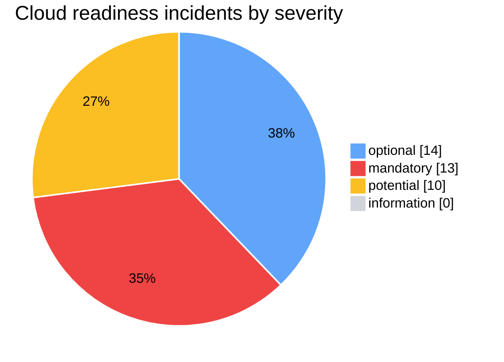
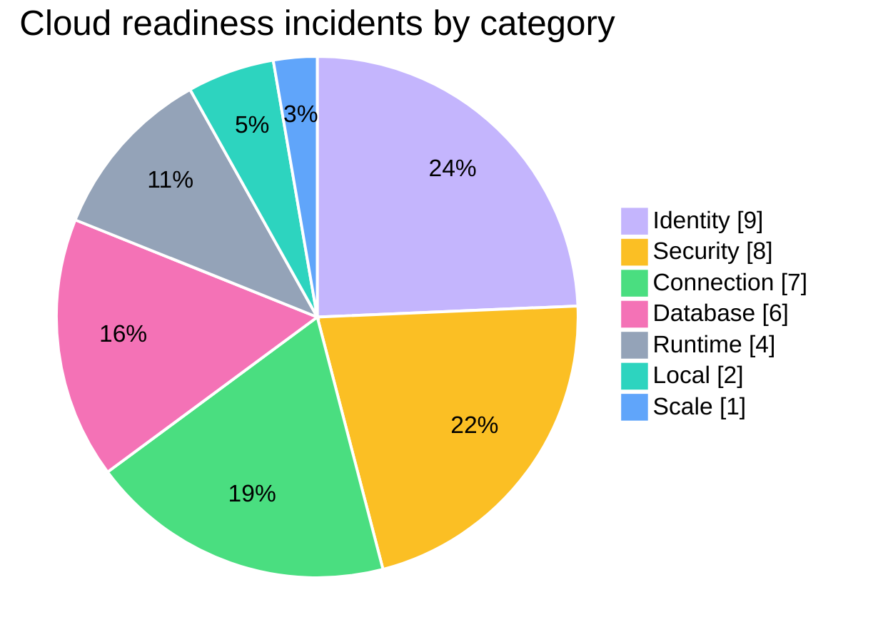
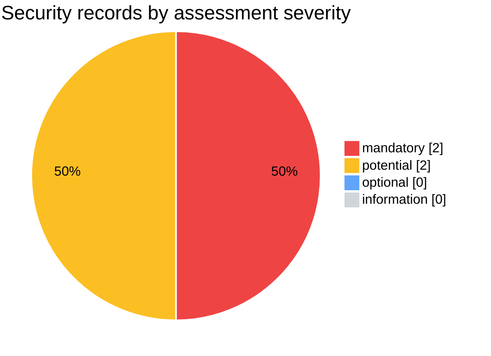
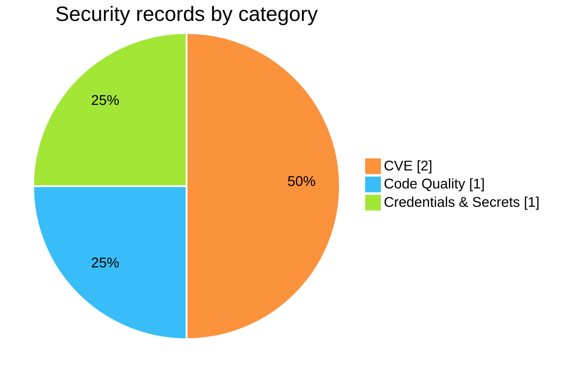
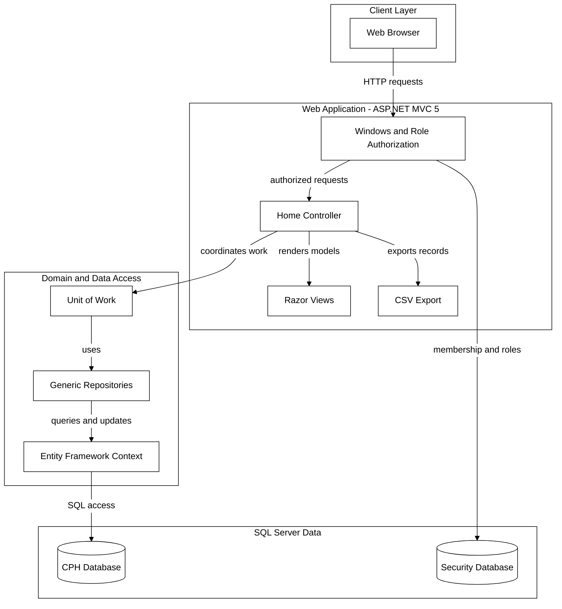
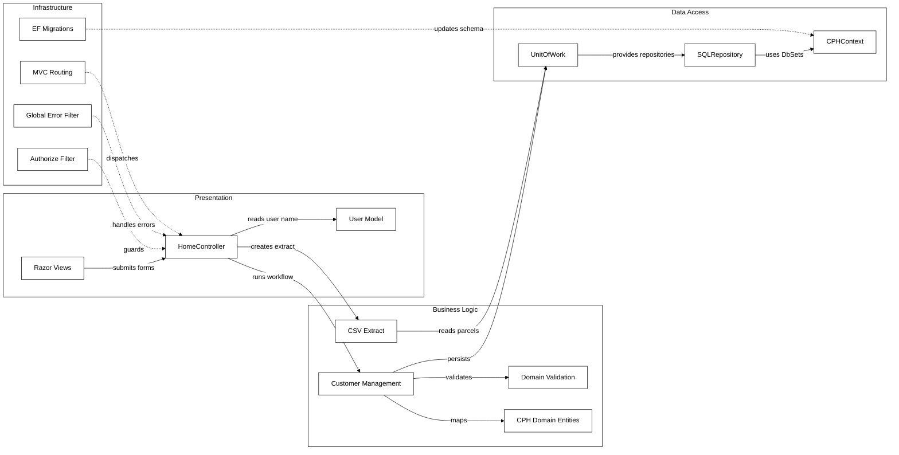
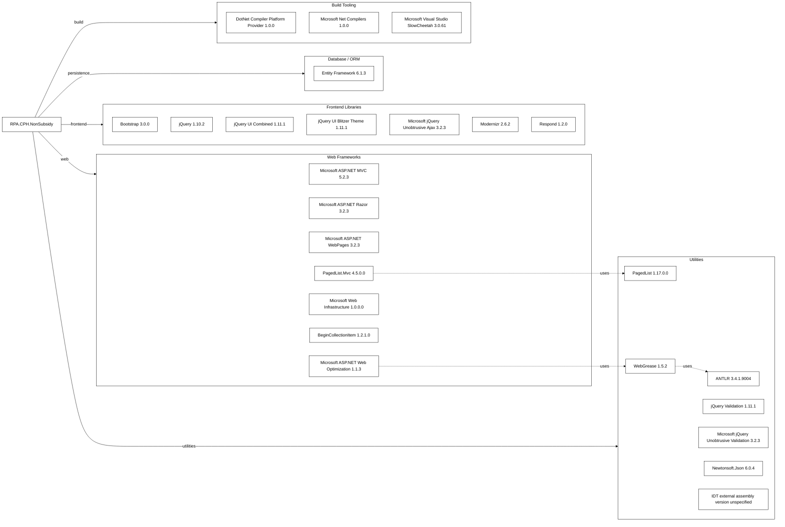
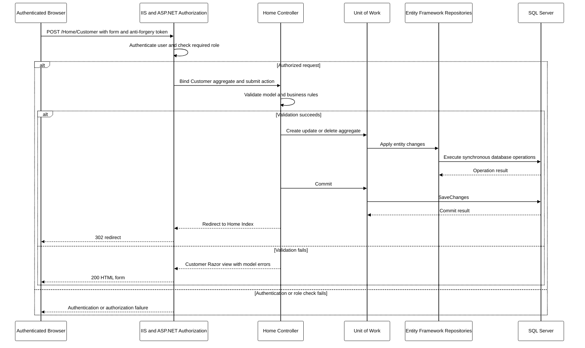
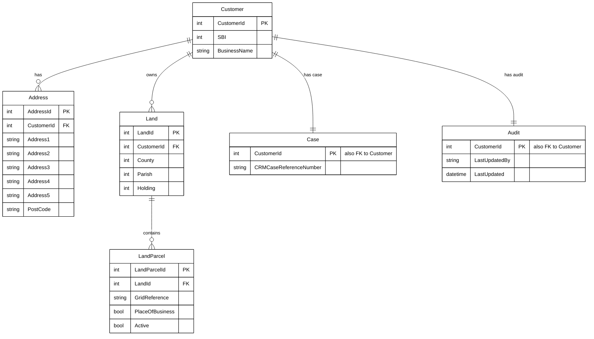
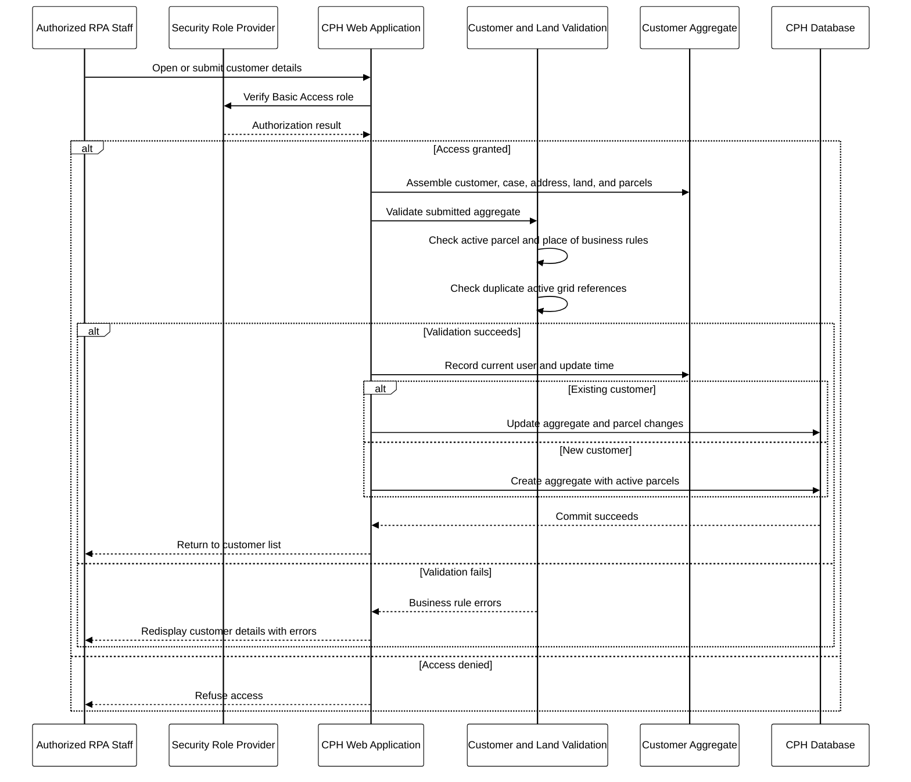

# Report_20261006101509 + Report_20261006102206: Combined Cloud Readiness and Security Assessment

This report merges two historical App Modernisation assessment runs of the `RPA.CPH.NonSubsidy` solution produced by the .NET AppCAT CLI on 6 October 2026. It is a reformatted export of existing artifacts, **not a fresh scan**. Cloud-readiness findings, the migration-solution mapping, and supporting analysis come from `.github/modernize/assessment/reports/report-20261006101509/` (full run); security findings come from `.github/modernize/assessment/reports/report-20261006102206/` (issue-only run covering the security and cloud-readiness domains). The second run reproduced identical cloud-readiness results, so they are shown once. Internal incident IDs are omitted here and remain in the source `report.json` files.

## Contents

- [Assessment Metadata](#assessment-metadata)
- [Assessment Summary](#assessment-summary)
  - [Cloud Readiness Charts](#cloud-readiness-charts)
  - [Security Charts](#security-charts)
- [Cloud Readiness Findings: Azure Container Apps](#cloud-readiness-findings-azure-container-apps)
  - [Project Overview](#project-overview)
  - [Findings Overview](#findings-overview)
  - [Runtime.0003: Old .NET Framework dependency detected](#runtime0003-old-net-framework-dependency-detected)
  - [Connection.0001: Connection string is detected](#connection0001-connection-string-is-detected)
  - [Identity.0002: Windows authentication detected](#identity0002-windows-authentication-detected)
  - [Security.0002: Connection strings without configuration builders detected](#security0002-connection-strings-without-configuration-builders-detected)
  - [Scale.0001: Static content detected](#scale0001-static-content-detected)
  - [Database.0002: SQL database connection detected](#database0002-sql-database-connection-detected)
  - [Database.0003: System.Data.SqlClient dependency detected](#database0003-systemdatasqlclient-dependency-detected)
  - [Local.0006: Hardcoded URLs detected](#local0006-hardcoded-urls-detected)
- [Security Findings](#security-findings)
  - [Security Findings Overview](#security-findings-overview)
  - [CVE Advisory Details](#cve-advisory-details)
- [Migration Solution Mapping](#migration-solution-mapping)
- [Supporting Analysis and Original Diagrams](#supporting-analysis-and-original-diagrams)
  - [Architecture Diagram](#architecture-diagram)
  - [Dependency Map](#dependency-map)
  - [API & Service Communication Contracts](#api--service-communication-contracts)
  - [Data Architecture & Persistence Layer](#data-architecture--persistence-layer)
  - [Configuration & Externalized Settings Inventory](#configuration--externalized-settings-inventory)
  - [Core Business Workflows](#core-business-workflows)
- [Source Notes and Discrepancies](#source-notes-and-discrepancies)

## Assessment Metadata

- **Report names / IDs:** `Report_20261006101509` (ID `20261006101509`) and `Report_20261006102206` (ID `20261006102206`)
- **Format / producer:** report format version `1.0.0` / .NET AppCAT CLI (both runs; source field `version` `1.0.0`, producer `.NET AppCAT CLI` in the security run)
- **Status / mode:** `20261006101509`: completed, `full` mode; `20261006102206`: completed, `issue-only` mode
- **Analysis window (UTC):** `20261006101509`: 2026-10-06T08:15:09.763Z to 2026-10-06T08:21:27.500Z; `20261006102206`: 2026-10-06T08:22:06.269Z to 2026-10-06T08:25:57.378Z
- **Privacy mode:** Protected ([help](https://aka.ms/appmod-privacy-mode)) for both runs
- **Target:** Azure Container Apps (`ACA`), the same in both runs
- **Domains:** `20261006101509`: `cloud-readiness`; `20261006102206`: `security`, `cloud-readiness`
- **CVE scan:** minimum severity `high`, scope `direct` (identical settings in both runs: `high` / `direct`)
- **Capabilities:** None specified (`20261006101509`); None specified (`20261006102206`)
- **Operating systems:** None specified (`20261006101509`); None specified (`20261006102206`)
- **Source sections used:** cloud-readiness projects/rules and `facts/` from `20261006101509`; `security` records (4) from `20261006102206` (the `20261006101509` run has 0 security records); `solution.json` is identical in both

## Assessment Summary

Cloud-readiness and security totals are reported separately; the source `summary` block covers cloud-readiness only and does not include security records or their story points.

| Group | Metric | Value |
|---|---|---:|
| Cloud readiness: overall | Projects analysed | 4 |
| Cloud readiness: overall | Distinct rule types (source `totalIssues`) | 8 |
| Cloud readiness: overall | Incidents | 37 |
| Cloud readiness: overall | Total effort (story points) | 107 |
| Cloud readiness: incidents by severity | mandatory | 13 |
| Cloud readiness: incidents by severity | potential | 10 |
| Cloud readiness: incidents by severity | optional | 14 |
| Cloud readiness: incidents by severity | information | 0 |
| Cloud readiness: incidents by category | Identity | 9 |
| Cloud readiness: incidents by category | Security | 8 |
| Cloud readiness: incidents by category | Connection | 7 |
| Cloud readiness: incidents by category | Database | 6 |
| Cloud readiness: incidents by category | Runtime | 4 |
| Cloud readiness: incidents by category | Local | 2 |
| Cloud readiness: incidents by category | Scale | 1 |
| Security: overall | Security records | 4 |
| Security: overall | CWE records | 2 |
| Security: overall | CVE records | 2 |
| Security: overall | Total effort (story points) | 8 |
| Security: records by assessment severity | mandatory | 2 |
| Security: records by assessment severity | potential | 2 |
| Security: records by assessment severity | optional | 0 |
| Security: records by assessment severity | information | 0 |
| Security: records by category | CVE | 2 |
| Security: records by category | Code Quality | 1 |
| Security: records by category | Credentials & Secrets | 1 |

### Cloud Readiness Charts

Colour key: optional = blue (`#60A5FA`); mandatory = red (`#EF4444`); potential = amber (`#FBBF24`); information = grey (`#D1D5DB`). `information` has 0 incidents, so it appears in the legend without a visible slice.

Colour key: Identity = violet (`#C4B5FD`); Security = amber (`#FBBF24`); Connection = green (`#4ADE80`); Database = pink (`#F472B6`); Runtime = slate (`#94A3B8`); Local = teal (`#2DD4BF`); Scale = blue (`#60A5FA`). Category colours distinguish groups only; they do not indicate severity.

### Security Charts

Colour key: mandatory = red (`#EF4444`); potential = amber (`#FBBF24`); optional = blue (`#60A5FA`); information = grey (`#D1D5DB`). `optional`, `information` have 0 records, so they appear in the legend without visible slices.

Colour key: CVE = orange (`#FB923C`); Code Quality = sky (`#38BDF8`); Credentials & Secrets = lime (`#A3E635`). Category colours distinguish groups only; they do not indicate severity.

## Cloud Readiness Findings: Azure Container Apps

The selected target is **Azure Container Apps** (`ACA`). Each incident also carries ratings for other Azure targets; these are shown per rule. Severity is the assessment's own scale (`mandatory`, `potential`, `optional`, `information`) and effort is in story points.

### Project Overview

| Project | Project file | Framework | Language | Build tool | Rule types | Incidents | Effort (story points) |
|---|---|---|---|---|---:|---:|---:|
| RPA.CPH.NonSubsidy.Domain | [RPA.CPH.NonSubsidy.Domain&#92;RPA.CPH.NonSubsidy.Domain.csproj](../RPA.CPH.NonSubsidy.Domain/RPA.CPH.NonSubsidy.Domain/RPA.CPH.NonSubsidy.Domain.csproj) | .NETFramework,Version=v4.5 | C# | MSBuild | 4 | 10 | 30 |
| RPA.CPH.NonSubsidy.Domain.Tests | [RPA.CPH.NonSubsidy.Domain.Tests&#92;RPA.CPH.NonSubsidy.Domain.Tests.csproj](../RPA.CPH.NonSubsidy.Domain/RPA.CPH.NonSubsidy.Domain.Tests/RPA.CPH.NonSubsidy.Domain.Tests.csproj) | .NETFramework,Version=v4.5 | C# | MSBuild | 1 | 1 | 3 |
| RPA.CPH.NonSubsidy.Web | [RPA.CPH.NonSubsidy.Web&#92;RPA.CPH.NonSubsidy.Web.csproj](../RPA.CPH.NonSubsidy.Domain/RPA.CPH.NonSubsidy.Web/RPA.CPH.NonSubsidy.Web.csproj) | .NETFramework,Version=v4.5 | C# | MSBuild | 8 | 24 | 68 |
| RPA.CPH.NonSubsidy.Web.Tests | [RPA.CPH.NonSubsidy.Web.Tests&#92;RPA.CPH.NonSubsidy.Web.Tests.csproj](../RPA.CPH.NonSubsidy.Domain/RPA.CPH.NonSubsidy.Web.Tests/RPA.CPH.NonSubsidy.Web.Tests.csproj) | .NETFramework,Version=v4.5 | C# | MSBuild | 2 | 2 | 6 |
| **Total** | | | | | 8 distinct | 37 | 107 |

Per-project rule-type counts overlap, so they sum to more than the solution-wide distinct total.

### Findings Overview

| Rule | Title | Category | Rule severity | ACA severity | Effort per incident (story points) | Incidents | Total ACA effort (story points) | Projects affected |
|---|---|---|---|---|---:|---:|---:|---|
| [Runtime.0003](#runtime0003-old-net-framework-dependency-detected) | Old .NET Framework dependency detected | Runtime | mandatory | mandatory | 3 | 4 | 12 | RPA.CPH.NonSubsidy.Domain, RPA.CPH.NonSubsidy.Domain.Tests, RPA.CPH.NonSubsidy.Web, RPA.CPH.NonSubsidy.Web.Tests |
| [Connection.0001](#connection0001-connection-string-is-detected) | Connection string is detected | Connection | potential | potential | 3 | 7 | 21 | RPA.CPH.NonSubsidy.Domain, RPA.CPH.NonSubsidy.Web |
| [Identity.0002](#identity0002-windows-authentication-detected) | Windows authentication detected | Identity | mandatory | mandatory | 3 | 9 | 27 | RPA.CPH.NonSubsidy.Domain, RPA.CPH.NonSubsidy.Web |
| [Security.0002](#security0002-connection-strings-without-configuration-builders-detected) | Connection strings without configuration builders detected | Security | optional | optional | 3 | 8 | 24 | RPA.CPH.NonSubsidy.Domain, RPA.CPH.NonSubsidy.Web, RPA.CPH.NonSubsidy.Web.Tests |
| [Scale.0001](#scale0001-static-content-detected) | Static content detected | Scale | optional | optional | 3 | 1 | 3 | RPA.CPH.NonSubsidy.Web |
| [Database.0002](#database0002-sql-database-connection-detected) | SQL database connection detected | Database | potential | potential | 3 | 1 | 3 | RPA.CPH.NonSubsidy.Web |
| [Database.0003](#database0003-systemdatasqlclient-dependency-detected) | System.Data.SqlClient dependency detected | Database | optional | optional | 3 | 5 | 15 | RPA.CPH.NonSubsidy.Web |
| [Local.0006](#local0006-hardcoded-urls-detected) | Hardcoded URLs detected | Local | potential | potential | 1 | 2 | 2 | RPA.CPH.NonSubsidy.Web |
| **Total** | | | | | | 37 | 107 | |

### Runtime.0003: Old .NET Framework dependency detected

- **Category:** Runtime; **rule severity:** mandatory; **effort per incident:** 3 story points; **incidents:** 4
- **Migration solution:** `runtime-compatibility-prompt`
- **Labels:** None specified

Applications running on frameworks older than .NET Framework 4.8 could have potential compatibility issues.

If you are targeting Managed Instance on Azure App Service, run the app on .NET Framework 4.8 (preinstalled) without retargeting if feasible; review runtime breaking changes and validate on Managed Instance staging.

Azure App Service runs apps on .NET Framework 4.8 or .NET Framework 3.5. Upgrade to a newer target framework or double check that your application works correctly when running on .NET Framework 4.8.

Apps that already run on .NET Framework 3.5 or .NET Framework 4.8 do not need changed even if they target an older framework version.

Although retargeting to .NET Framework 4.8 will address this issue, it is not necessary. It is only necessary to ensure that the app runs correctly on .NET Framework 3.5 or .NET Framework 4.8. Applications built against older versions of the .NET Framework can run on newer versions (like 4.8) and the runtime will automatically tweak certain behaviors so that the runtime behaves as much as possible as the targeted version. Breaking change documentation mentions both runtime breaking changes and retargeting breaking changes. Runtime breaking changes refer to differences in behavior when applications are run on a newer version of the .NET Framework. These are the behavioral differences which cannot be tweaked away and will matter for applications migrating to Azure App Service. Retargeting breaking changes are changes which only manifest when an app targets a newer version of the .NET Framework. These should not cause issues during App Service migration scenarios because apps do not need re-targeted.

Actions to address this issue:

1. Review breaking changes between the version of the .NET Framework the application runs on now and .NET Framework 4.8 to make sure none are likely to affect the application.
2. Test the application running on .NET Framework 3.5 or .NET Framework 4.8 to ensure it works as expected.

**References:**

- [.NET Framework Breaking Changes](https://go.microsoft.com/fwlink/?linkid=2250029)
- [.NET Framework 4.8 on App Service](https://go.microsoft.com/fwlink/?linkid=2251730)
- [Configuration builders for ASP.NET](https://go.microsoft.com/fwlink/?linkid=2251829)

**Target ratings** (identical for all 4 incident(s)):

| Target | Severity | Effort (story points) |
|---|---|---:|
| AppService.Windows | potential | 3 |
| AppService.Linux | mandatory | 3 |
| AKS.Linux | mandatory | 3 |
| AKS.Windows | potential | 3 |
| **ACA** (selected target) | mandatory | 3 |
| AppServiceContainer.Linux | mandatory | 3 |
| AppServiceContainer.Windows | potential | 3 |
| AppServiceManagedInstance.Windows | potential | 3 |

**Incident evidence:**

| # | Project | Location | Line:Column | Location kind | Labels | Evidence |
|---:|---|---|---|---|---|---|
| 1 | RPA.CPH.NonSubsidy.Domain | [RPA.CPH.NonSubsidy.Domain&#92;RPA.CPH.NonSubsidy.Domain.csproj](../RPA.CPH.NonSubsidy.Domain/RPA.CPH.NonSubsidy.Domain/RPA.CPH.NonSubsidy.Domain.csproj) | Not supplied | File | None | <code>Target framework: .NETFramework,Version=v4.5</code> |
| 2 | RPA.CPH.NonSubsidy.Domain.Tests | [RPA.CPH.NonSubsidy.Domain.Tests&#92;RPA.CPH.NonSubsidy.Domain.Tests.csproj](../RPA.CPH.NonSubsidy.Domain/RPA.CPH.NonSubsidy.Domain.Tests/RPA.CPH.NonSubsidy.Domain.Tests.csproj) | Not supplied | File | None | <code>Target framework: .NETFramework,Version=v4.5</code> |
| 3 | RPA.CPH.NonSubsidy.Web | [RPA.CPH.NonSubsidy.Web&#92;RPA.CPH.NonSubsidy.Web.csproj](../RPA.CPH.NonSubsidy.Domain/RPA.CPH.NonSubsidy.Web/RPA.CPH.NonSubsidy.Web.csproj) | Not supplied | File | None | <code>Target framework: .NETFramework,Version=v4.5</code> |
| 4 | RPA.CPH.NonSubsidy.Web.Tests | [RPA.CPH.NonSubsidy.Web.Tests&#92;RPA.CPH.NonSubsidy.Web.Tests.csproj](../RPA.CPH.NonSubsidy.Domain/RPA.CPH.NonSubsidy.Web.Tests/RPA.CPH.NonSubsidy.Web.Tests.csproj) | Not supplied | File | None | <code>Target framework: .NETFramework,Version=v4.5</code> |

### Connection.0001: Connection string is detected

- **Category:** Connection; **rule severity:** potential; **effort per incident:** 3 story points; **incidents:** 7
- **Migration solution:** `plaintext-credential-to-azure-keyvault`
- **Labels:** None specified

Connection string detected. It may not be available when your app is migrated to Azure.

Review and ensure it works from Azure. If you are connecting to a database, you might need to migrate the database to Azure. There are multiple ways to do it:

1. Migrate to Azure SQL Database for additional benefits (see the link below).
2. Consider Azure SQL Managed Instance if you need features that are not available in Azure SQL Database and you don’t want to use a VM.
3. Migrate your database servers directly to SQL Server on Azure VMs.

To assess database migration effort, you can use Azure Migrate tool, see the link below.

**References:**

- [Migrate SQL Server database to Azure](https://go.microsoft.com/fwlink/?LinkID=2251731)
- [Azure SQL Managed Instance](https://go.microsoft.com/fwlink/?LinkID=2251613)
- [Azure Migrate](https://go.microsoft.com/fwlink/?linkid=2252410)

**Target ratings** (identical for all 7 incident(s)):

| Target | Severity | Effort (story points) |
|---|---|---:|
| AppService.Windows | potential | 3 |
| AppService.Linux | potential | 3 |
| AKS.Linux | potential | 3 |
| AKS.Windows | potential | 3 |
| **ACA** (selected target) | potential | 3 |
| AppServiceContainer.Linux | potential | 3 |
| AppServiceContainer.Windows | potential | 3 |
| AppServiceManagedInstance.Windows | potential | 3 |

**Incident evidence:**

| # | Project | Location | Line:Column | Location kind | Labels | Evidence |
|---:|---|---|---|---|---|---|
| 1 | RPA.CPH.NonSubsidy.Domain | [RPA.CPH.NonSubsidy.Domain&#92;App.config](../RPA.CPH.NonSubsidy.Domain/RPA.CPH.NonSubsidy.Domain/App.config) | Not supplied | File | None | <code>&lt;add name="CPHContext" /&gt;</code> |
| 2 | RPA.CPH.NonSubsidy.Domain | [RPA.CPH.NonSubsidy.Domain&#92;App.Production.config](../RPA.CPH.NonSubsidy.Domain/RPA.CPH.NonSubsidy.Domain/App.Production.config) | Not supplied | File | None | <code>&lt;add name="CPHContext" /&gt;</code> |
| 3 | RPA.CPH.NonSubsidy.Domain | [RPA.CPH.NonSubsidy.Domain&#92;App.SIT.config](../RPA.CPH.NonSubsidy.Domain/RPA.CPH.NonSubsidy.Domain/App.SIT.config) | Not supplied | File | None | <code>&lt;add name="CPHContext" /&gt;</code> |
| 4 | RPA.CPH.NonSubsidy.Web | [RPA.CPH.NonSubsidy.Web&#92;Web.config](../RPA.CPH.NonSubsidy.Domain/RPA.CPH.NonSubsidy.Web/Web.config) | Not supplied | File | None | <code>&lt;add name="CPHContext" /&gt;</code> |
| 5 | RPA.CPH.NonSubsidy.Web | [RPA.CPH.NonSubsidy.Web&#92;Web.Production.config](../RPA.CPH.NonSubsidy.Domain/RPA.CPH.NonSubsidy.Web/Web.Production.config) | Not supplied | File | None | <code>&lt;add name="CPHContext" /&gt;</code> |
| 6 | RPA.CPH.NonSubsidy.Web | [RPA.CPH.NonSubsidy.Web&#92;Web.SIT.config](../RPA.CPH.NonSubsidy.Domain/RPA.CPH.NonSubsidy.Web/Web.SIT.config) | Not supplied | File | None | <code>&lt;add name="CPHContext" /&gt;</code> |
| 7 | RPA.CPH.NonSubsidy.Web | [RPA.CPH.NonSubsidy.Web&#92;Web.UAT.config](../RPA.CPH.NonSubsidy.Domain/RPA.CPH.NonSubsidy.Web/Web.UAT.config) | Not supplied | File | None | <code>&lt;add name="CPHContext" /&gt;</code> |

### Identity.0002: Windows authentication detected

- **Category:** Identity; **rule severity:** mandatory; **effort per incident:** 3 story points; **incidents:** 9
- **Migration solution:** `windows-ad-to-azure-ad`
- **Labels:** None specified

Your app is using windows authentication which is not supported on Azure App Service, Azure Container Apps and Azure Kubernetes Service.

Azure App Service provides built-in authentication and authorization capabilities, so you can sign in users and access data by writing minimal or no code in your web app.

Follow the link below for more information."

**References:**

- [https://go.microsoft.com/fwlink/?LinkID=2242883](https://go.microsoft.com/fwlink/?LinkID=2242883)

**Target ratings** (identical for all 9 incident(s)):

| Target | Severity | Effort (story points) |
|---|---|---:|
| AppService.Windows | mandatory | 3 |
| AppService.Linux | mandatory | 3 |
| AKS.Linux | mandatory | 3 |
| AKS.Windows | potential | 3 |
| **ACA** (selected target) | mandatory | 3 |
| AppServiceContainer.Linux | mandatory | 3 |
| AppServiceContainer.Windows | mandatory | 3 |
| AppServiceManagedInstance.Windows | mandatory | 3 |

**Incident evidence:**

| # | Project | Location | Line:Column | Location kind | Labels | Evidence |
|---:|---|---|---|---|---|---|
| 1 | RPA.CPH.NonSubsidy.Domain | [RPA.CPH.NonSubsidy.Domain&#92;App.config](../RPA.CPH.NonSubsidy.Domain/RPA.CPH.NonSubsidy.Domain/App.config) | Not supplied | File | None | <code>&lt;add name="CPHContext" /&gt;</code> |
| 2 | RPA.CPH.NonSubsidy.Domain | [RPA.CPH.NonSubsidy.Domain&#92;App.Production.config](../RPA.CPH.NonSubsidy.Domain/RPA.CPH.NonSubsidy.Domain/App.Production.config) | Not supplied | File | None | <code>&lt;add name="CPHContext" /&gt;</code> |
| 3 | RPA.CPH.NonSubsidy.Domain | [RPA.CPH.NonSubsidy.Domain&#92;App.SIT.config](../RPA.CPH.NonSubsidy.Domain/RPA.CPH.NonSubsidy.Domain/App.SIT.config) | Not supplied | File | None | <code>&lt;add name="CPHContext" /&gt;</code> |
| 4 | RPA.CPH.NonSubsidy.Web | [RPA.CPH.NonSubsidy.Web&#92;Web.config](../RPA.CPH.NonSubsidy.Domain/RPA.CPH.NonSubsidy.Web/Web.config) | Not supplied | File | None | <code>&lt;add name="CPHContext" /&gt;</code> |
| 5 | RPA.CPH.NonSubsidy.Web | [RPA.CPH.NonSubsidy.Web&#92;Web.config](../RPA.CPH.NonSubsidy.Domain/RPA.CPH.NonSubsidy.Web/Web.config) | Not supplied | File | None | <code>&lt;add name="IDTSecurityConnection" /&gt;</code> |
| 6 | RPA.CPH.NonSubsidy.Web | [RPA.CPH.NonSubsidy.Web&#92;Web.config](../RPA.CPH.NonSubsidy.Domain/RPA.CPH.NonSubsidy.Web/Web.config) | Not supplied | File | None | <code>&lt;authentication /&gt;</code> |
| 7 | RPA.CPH.NonSubsidy.Web | [RPA.CPH.NonSubsidy.Web&#92;Web.Production.config](../RPA.CPH.NonSubsidy.Domain/RPA.CPH.NonSubsidy.Web/Web.Production.config) | Not supplied | File | None | <code>&lt;add name="CPHContext" /&gt;</code> |
| 8 | RPA.CPH.NonSubsidy.Web | [RPA.CPH.NonSubsidy.Web&#92;Web.SIT.config](../RPA.CPH.NonSubsidy.Domain/RPA.CPH.NonSubsidy.Web/Web.SIT.config) | Not supplied | File | None | <code>&lt;add name="CPHContext" /&gt;</code> |
| 9 | RPA.CPH.NonSubsidy.Web | [RPA.CPH.NonSubsidy.Web&#92;Web.UAT.config](../RPA.CPH.NonSubsidy.Domain/RPA.CPH.NonSubsidy.Web/Web.UAT.config) | Not supplied | File | None | <code>&lt;add name="CPHContext" /&gt;</code> |

### Security.0002: Connection strings without configuration builders detected

- **Category:** Security; **rule severity:** optional; **effort per incident:** 3 story points; **incidents:** 8
- **Migration solution:** `plaintext-credential-to-azure-keyvault`
- **Labels:** None specified

Connection strings without configuration builders detected.

Keeping connection strings directly in the app is not the best practice and might introduce security risks, increased maintenance, scalability challenges or compliance standards (such as PCI DSS, GDPR, etc.).

Instead, it is recommended to use configuration builders to get secrets from secure sources in Azure environment.

**References:**

- [Configuration builders](https://go.microsoft.com/fwlink/?LinkID=2250915)
- [Storing application secrets](https://go.microsoft.com/fwlink/?LinkID=2250916)
- [Centralized app configuration and security](https://go.microsoft.com/fwlink/?LinkID=2250733)

**Target ratings** (identical for all 8 incident(s)):

| Target | Severity | Effort (story points) |
|---|---|---:|
| AppService.Windows | optional | 3 |
| AppService.Linux | optional | 3 |
| AKS.Linux | optional | 3 |
| AKS.Windows | optional | 3 |
| **ACA** (selected target) | optional | 3 |
| AppServiceContainer.Linux | optional | 3 |
| AppServiceContainer.Windows | optional | 3 |
| AppServiceManagedInstance.Windows | optional | 3 |

**Incident evidence:**

| # | Project | Location | Line:Column | Location kind | Labels | Evidence |
|---:|---|---|---|---|---|---|
| 1 | RPA.CPH.NonSubsidy.Domain | [RPA.CPH.NonSubsidy.Domain&#92;App.config](../RPA.CPH.NonSubsidy.Domain/RPA.CPH.NonSubsidy.Domain/App.config) | Not supplied | File | None | <code>&lt;connectionStrings /&gt;</code> |
| 2 | RPA.CPH.NonSubsidy.Domain | [RPA.CPH.NonSubsidy.Domain&#92;App.Production.config](../RPA.CPH.NonSubsidy.Domain/RPA.CPH.NonSubsidy.Domain/App.Production.config) | Not supplied | File | None | <code>&lt;connectionStrings /&gt;</code> |
| 3 | RPA.CPH.NonSubsidy.Domain | [RPA.CPH.NonSubsidy.Domain&#92;App.SIT.config](../RPA.CPH.NonSubsidy.Domain/RPA.CPH.NonSubsidy.Domain/App.SIT.config) | Not supplied | File | None | <code>&lt;connectionStrings /&gt;</code> |
| 4 | RPA.CPH.NonSubsidy.Web | [RPA.CPH.NonSubsidy.Web&#92;Web.config](../RPA.CPH.NonSubsidy.Domain/RPA.CPH.NonSubsidy.Web/Web.config) | Not supplied | File | None | <code>&lt;connectionStrings /&gt;</code> |
| 5 | RPA.CPH.NonSubsidy.Web | [RPA.CPH.NonSubsidy.Web&#92;Web.Production.config](../RPA.CPH.NonSubsidy.Domain/RPA.CPH.NonSubsidy.Web/Web.Production.config) | Not supplied | File | None | <code>&lt;connectionStrings /&gt;</code> |
| 6 | RPA.CPH.NonSubsidy.Web | [RPA.CPH.NonSubsidy.Web&#92;Web.SIT.config](../RPA.CPH.NonSubsidy.Domain/RPA.CPH.NonSubsidy.Web/Web.SIT.config) | Not supplied | File | None | <code>&lt;connectionStrings /&gt;</code> |
| 7 | RPA.CPH.NonSubsidy.Web | [RPA.CPH.NonSubsidy.Web&#92;Web.UAT.config](../RPA.CPH.NonSubsidy.Domain/RPA.CPH.NonSubsidy.Web/Web.UAT.config) | Not supplied | File | None | <code>&lt;connectionStrings /&gt;</code> |
| 8 | RPA.CPH.NonSubsidy.Web.Tests | [RPA.CPH.NonSubsidy.Web.Tests&#92;App.config](../RPA.CPH.NonSubsidy.Domain/RPA.CPH.NonSubsidy.Web.Tests/App.config) | Not supplied | File | None | <code>&lt;connectionStrings /&gt;</code> |

### Scale.0001: Static content detected

- **Category:** Scale; **rule severity:** optional; **effort per incident:** 3 story points; **incidents:** 1
- **Migration solution:** `local-file-to-azure-blob-storage`
- **Labels:** None specified

Static content detected.

Your current approach of serving static content directly might lead to increased costs, performance issues, maintenance challenges (requiring application redeployment for content changes), and security risks.

Consider moving static content to Azure Blob Storage and adding Azure CDN.

**References:**

- [Azure Blob Storage](https://go.microsoft.com/fwlink/?linkid=2250574)
- [Azure CDN](https://go.microsoft.com/fwlink/?linkid=2250392)

**Target ratings** (identical for all 1 incident(s)):

| Target | Severity | Effort (story points) |
|---|---|---:|
| AppService.Windows | optional | 3 |
| AppService.Linux | optional | 3 |
| AKS.Linux | optional | 3 |
| AKS.Windows | optional | 3 |
| **ACA** (selected target) | optional | 3 |
| AppServiceContainer.Linux | optional | 3 |
| AppServiceContainer.Windows | optional | 3 |
| AppServiceManagedInstance.Windows | optional | 3 |

**Incident evidence:**

| # | Project | Location | Line:Column | Location kind | Labels | Evidence |
|---:|---|---|---|---|---|---|
| 1 | RPA.CPH.NonSubsidy.Web | [RPA.CPH.NonSubsidy.Web&#92;RPA.CPH.NonSubsidy.Web.csproj](../RPA.CPH.NonSubsidy.Domain/RPA.CPH.NonSubsidy.Web/RPA.CPH.NonSubsidy.Web.csproj) | Not supplied | File | None | <code>Found 169 files matching the rule:  assets&#92;govuk&#92;fonts&#92;NTA-Bold-20130221.eot assets&#92;govuk&#92;fonts&#92;NTA-Bold-20130221.woff assets&#92;govuk&#92;fonts&#92;NTA-Light-20130221.eot assets&#92;govuk&#92;fonts&#92;NTA-Light-20130221.woff assets&#92;govuk&#92;fonts&#92;NTATabularNumbers-Bold.eot assets&#92;govuk&#92;fonts&#92;NTATabularNumbers-Bold.woff assets&#92;govuk&#92;fonts&#92;NTATabularNumbers-Light.eot assets&#92;govuk&#92;fonts&#92;NTATabularNumbers-Light.woff assets&#92;govuk&#92;images&#92;apple-touch-icon-114x114.png assets&#92;govuk&#92;images&#92;apple-touch-icon-144x144.png assets&#92;govuk&#92;images&#92;apple-touch-icon-57x57.png assets&#92;govuk&#92;images&#92;apple-touch-icon-72x72.png assets&#92;govuk&#92;images&#92;close.png assets&#92;govuk&#92;images&#92;external-links&#92;external-link-24x24.png assets&#92;govuk&#92;images&#92;external-links&#92;external-link-black-12x12.png assets&#92;govuk&#92;images&#92;external-links&#92;external-link-black-24x24.png assets&#92;govuk&#92;images&#92;external-links&#92;external-link.png assets&#92;govuk&#92;images&#92;gov.uk&#95;logotype&#95;crown&#95;invert&#95;trans.png assets&#92;govuk&#92;images&#92;gov.uk&#95;logotype&#95;crown&#95;invert.png assets&#92;govuk&#92;images&#92;gov.uk&#95;logotype&#95;crown.png assets&#92;govuk&#92;images&#92;govuk-crest-2x.png assets&#92;govuk&#92;images&#92;govuk-crest-ie.png assets&#92;govuk&#92;images&#92;govuk-crest.png assets&#92;govuk&#92;images&#92;icons&#92;accordian-arrow-2x.png assets&#92;govuk&#92;images&#92;icons&#92;accordian-arrow.png assets&#92;govuk&#92;images&#92;icons&#92;arrow-sprite.png assets&#92;govuk&#92;images&#92;icons&#92;crests&#92;org&#95;crest&#95;13px&#95;x2.png assets&#92;govuk&#92;images&#92;icons&#92;crests&#92;org&#95;crest&#95;18px&#95;x2.png assets&#92;govuk&#92;images&#92;icons&#92;crests&#92;org&#95;crest&#95;18px.png assets&#92;govuk&#92;images&#92;icons&#92;crests&#92;org&#95;crest&#95;27px&#95;x2.png assets&#92;govuk&#92;images&#92;icons&#92;crests&#92;org&#95;crest&#95;27px.png assets&#92;govuk&#92;images&#92;icons&#92;external-links&#92;external-link-24x24.png assets&#92;govuk&#92;images&#92;icons&#92;external-links&#92;external-link-black-12x12.png assets&#92;govuk&#92;images&#92;icons&#92;external-links&#92;external-link-black-24x24.png assets&#92;govuk&#92;images&#92;icons&#92;external-links&#92;external-link.png assets&#92;govuk&#92;images&#92;icons&#92;icon-calendar-2x.png assets&#92;govuk&#92;images&#92;icons&#92;icon-calendar.png assets&#92;govuk&#92;images&#92;icons&#92;icon-file-download-2x.png assets&#92;govuk&#92;images&#92;icons&#92;icon-file-download.png assets&#92;govuk&#92;images&#92;icons&#92;icon-important-2x.png assets&#92;govuk&#92;images&#92;icons&#92;icon-important.png assets&#92;govuk&#92;images&#92;icons&#92;icon-information-2x.png assets&#92;govuk&#92;images&#92;icons&#92;icon-information.png assets&#92;govuk&#92;images&#92;icons&#92;icon-locator-2x.png assets&#92;govuk&#92;images&#92;icons&#92;icon-locator.png assets&#92;govuk&#92;images&#92;icons&#92;icon-pointer-2x.png assets&#92;govuk&#92;images&#92;icons&#92;icon-pointer-black-2x.png assets&#92;govuk&#92;images&#92;icons&#92;icon-pointer-black.png assets&#92;govuk&#92;images&#92;icons&#92;icon-pointer-indexed.png assets&#92;govuk&#92;images&#92;icons&#92;icon-pointer.png assets&#92;govuk&#92;images&#92;icons&#92;icon-search-2x.png assets&#92;govuk&#92;images&#92;icons&#92;icon-search.png assets&#92;govuk&#92;images&#92;icons&#92;icon-steps&#92;checklist-2x.png assets&#92;govuk&#92;images&#92;icons&#92;icon-steps&#92;checklist.png assets&#92;govuk&#92;images&#92;icons&#92;icon-steps&#92;icon-step-1-2x.png assets&#92;govuk&#92;images&#92;icons&#92;icon-steps&#92;icon-step-1.png assets&#92;govuk&#92;images&#92;icons&#92;icon-steps&#92;icon-step-10-2x.png assets&#92;govuk&#92;images&#92;icons&#92;icon-steps&#92;icon-step-10.png assets&#92;govuk&#92;images&#92;icons&#92;icon-steps&#92;icon-step-11-2x.png assets&#92;govuk&#92;images&#92;icons&#92;icon-steps&#92;icon-step-11.png assets&#92;govuk&#92;images&#92;icons&#92;icon-steps&#92;icon-step-12-2x.png assets&#92;govuk&#92;images&#92;icons&#92;icon-steps&#92;icon-step-12.png assets&#92;govuk&#92;images&#92;icons&#92;icon-steps&#92;icon-step-13-2x.png assets&#92;govuk&#92;images&#92;icons&#92;icon-steps&#92;icon-step-13.png assets&#92;govuk&#92;images&#92;icons&#92;icon-steps&#92;icon-step-14-2x.png assets&#92;govuk&#92;images&#92;icons&#92;icon-steps&#92;icon-step-14.png assets&#92;govuk&#92;images&#92;icons&#92;icon-steps&#92;icon-step-2-2x.png assets&#92;govuk&#92;images&#92;icons&#92;icon-steps&#92;icon-step-2.png assets&#92;govuk&#92;images&#92;icons&#92;icon-steps&#92;icon-step-3-2x.png assets&#92;govuk&#92;images&#92;icons&#92;icon-steps&#92;icon-step-3.png assets&#92;govuk&#92;images&#92;icons&#92;icon-steps&#92;icon-step-4-2x.png assets&#92;govuk&#92;images&#92;icons&#92;icon-steps&#92;icon-step-4.png assets&#92;govuk&#92;images&#92;icons&#92;icon-steps&#92;icon-step-5-2x.png assets&#92;govuk&#92;images&#92;icons&#92;icon-steps&#92;icon-step-5.png assets&#92;govuk&#92;images&#92;icons&#92;icon-steps&#92;icon-step-6-2x.png assets&#92;govuk&#92;images&#92;icons&#92;icon-steps&#92;icon-step-6.png assets&#92;govuk&#92;images&#92;icons&#92;icon-steps&#92;icon-step-7-2x.png assets&#92;govuk&#92;images&#92;icons&#92;icon-steps&#92;icon-step-7.png assets&#92;govuk&#92;images&#92;icons&#92;icon-steps&#92;icon-step-8-2x.png assets&#92;govuk&#92;images&#92;icons&#92;icon-steps&#92;icon-step-8.png assets&#92;govuk&#92;images&#92;icons&#92;icon-steps&#92;icon-step-9-2x.png assets&#92;govuk&#92;images&#92;icons&#92;icon-steps&#92;icon-step-9.png assets&#92;govuk&#92;images&#92;icons&#92;player-icon-forward.png assets&#92;govuk&#92;images&#92;icons&#92;player-icon-pause.png assets&#92;govuk&#92;images&#92;icons&#92;player-icon-play.png assets&#92;govuk&#92;images&#92;icons&#92;player-icon-rewind.png assets&#92;govuk&#92;images&#92;icons&#92;player-icon-volume.png assets&#92;govuk&#92;images&#92;open-government-licence&#95;2x.png assets&#92;govuk&#92;images&#92;open-government-licence.png assets&#92;govuk&#92;images&#92;opengraph-image.png assets&#92;govuk&#92;stylesheets&#92;fonts-ie8.css assets&#92;govuk&#92;stylesheets&#92;fonts.css assets&#92;govuk&#92;stylesheets&#92;govuk-template-ie8.css assets&#92;govuk&#92;stylesheets&#92;govuk-template-print.css assets&#92;govuk&#92;stylesheets&#92;govuk-template.css Content&#92;bootstrap.css Content&#92;bootstrap.min.css Content&#92;PagedList.css Content&#92;Site.css Content&#92;themes&#92;base&#92;accordion.css Content&#92;themes&#92;base&#92;all.css Content&#92;themes&#92;base&#92;autocomplete.css Content&#92;themes&#92;base&#92;base.css Content&#92;themes&#92;base&#92;button.css Content&#92;themes&#92;base&#92;core.css Content&#92;themes&#92;base&#92;datepicker.css Content&#92;themes&#92;base&#92;dialog.css Content&#92;themes&#92;base&#92;draggable.css Content&#92;themes&#92;base&#92;images&#92;ui-bg&#95;flat&#95;0&#95;aaaaaa&#95;40x100.png Content&#92;themes&#92;base&#92;images&#92;ui-bg&#95;flat&#95;75&#95;ffffff&#95;40x100.png Content&#92;themes&#92;base&#92;images&#92;ui-bg&#95;glass&#95;55&#95;fbf9ee&#95;1x400.png Content&#92;themes&#92;base&#92;images&#92;ui-bg&#95;glass&#95;65&#95;ffffff&#95;1x400.png Content&#92;themes&#92;base&#92;images&#92;ui-bg&#95;glass&#95;75&#95;dadada&#95;1x400.png Content&#92;themes&#92;base&#92;images&#92;ui-bg&#95;glass&#95;75&#95;e6e6e6&#95;1x400.png Content&#92;themes&#92;base&#92;images&#92;ui-bg&#95;glass&#95;95&#95;fef1ec&#95;1x400.png Content&#92;themes&#92;base&#92;images&#92;ui-bg&#95;highlight-soft&#95;75&#95;cccccc&#95;1x100.png Content&#92;themes&#92;base&#92;images&#92;ui-icons&#95;222222&#95;256x240.png Content&#92;themes&#92;base&#92;images&#92;ui-icons&#95;2e83ff&#95;256x240.png Content&#92;themes&#92;base&#92;images&#92;ui-icons&#95;454545&#95;256x240.png Content&#92;themes&#92;base&#92;images&#92;ui-icons&#95;888888&#95;256x240.png Content&#92;themes&#92;base&#92;images&#92;ui-icons&#95;cd0a0a&#95;256x240.png Content&#92;themes&#92;base&#92;menu.css Content&#92;themes&#92;base&#92;progressbar.css Content&#92;themes&#92;base&#92;resizable.css Content&#92;themes&#92;base&#92;selectable.css Content&#92;themes&#92;base&#92;selectmenu.css Content&#92;themes&#92;base&#92;slider.css Content&#92;themes&#92;base&#92;sortable.css Content&#92;themes&#92;base&#92;spinner.css Content&#92;themes&#92;base&#92;tabs.css Content&#92;themes&#92;base&#92;theme.css Content&#92;themes&#92;base&#92;tooltip.css Content&#92;themes&#92;blitzer&#92;images&#92;ui-bg&#95;diagonals-thick&#95;75&#95;f3d8d8&#95;40x40.png Content&#92;themes&#92;blitzer&#92;images&#92;ui-bg&#95;dots-small&#95;65&#95;a6a6a6&#95;2x2.png Content&#92;themes&#92;blitzer&#92;images&#92;ui-bg&#95;flat&#95;0&#95;333333&#95;40x100.png Content&#92;themes&#92;blitzer&#92;images&#92;ui-bg&#95;flat&#95;65&#95;ffffff&#95;40x100.png Content&#92;themes&#92;blitzer&#92;images&#92;ui-bg&#95;flat&#95;75&#95;ffffff&#95;40x100.png Content&#92;themes&#92;blitzer&#92;images&#92;ui-bg&#95;glass&#95;55&#95;fbf8ee&#95;1x400.png Content&#92;themes&#92;blitzer&#92;images&#92;ui-bg&#95;highlight-hard&#95;100&#95;eeeeee&#95;1x100.png Content&#92;themes&#92;blitzer&#92;images&#92;ui-bg&#95;highlight-hard&#95;100&#95;f6f6f6&#95;1x100.png Content&#92;themes&#92;blitzer&#92;images&#92;ui-bg&#95;highlight-soft&#95;15&#95;cc0000&#95;1x100.png Content&#92;themes&#92;blitzer&#92;images&#92;ui-icons&#95;004276&#95;256x240.png Content&#92;themes&#92;blitzer&#92;images&#92;ui-icons&#95;cc0000&#95;256x240.png Content&#92;themes&#92;blitzer&#92;images&#92;ui-icons&#95;ffffff&#95;256x240.png Content&#92;themes&#92;blitzer&#92;jquery-ui.blitzer.css Content&#92;themes&#92;blitzer&#92;jquery-ui.blitzer.min.css favicon.ico fonts&#92;glyphicons-halflings-regular.eot fonts&#92;glyphicons-halflings-regular.svg fonts&#92;glyphicons-halflings-regular.ttf fonts&#92;glyphicons-halflings-regular.woff images&#92;Icon&#95;inverted-6.png images&#92;Icon.ico Scripts&#92;&#95;references.js Scripts&#92;bootstrap.js Scripts&#92;bootstrap.min.js Scripts&#92;jquery-1.10.2.js Scripts&#92;jquery-1.10.2.min.js Scripts&#92;jquery-ui-1.11.1.js Scripts&#92;jquery-ui.min-1.11.1.js Scripts&#92;jquery.unobtrusive-ajax.js Scripts&#92;jquery.unobtrusive-ajax.min.js Scripts&#92;jquery.validate.js Scripts&#92;jquery.validate.min.js Scripts&#92;jquery.validate.unobtrusive.js Scripts&#92;jquery.validate.unobtrusive.min.js Scripts&#92;modernizr-2.6.2.js Scripts&#92;respond.js Scripts&#92;respond.min.js </code> |

### Database.0002: SQL database connection detected

- **Category:** Database; **rule severity:** potential; **effort per incident:** 3 story points; **incidents:** 1
- **Migration solution:** `local-sql-server-to-azure-sql-db`
- **Labels:** None specified

SQL database connection detected.

Ensure the database is available/reachable on Azure.

If it is not, there are multiple ways you can move your data to Azure:

1. Migrate to Azure SQL Database.
2. Consider Azure SQL Managed Instance if you need features that are not available in Azure SQL Database and you don’t want to use a VM.
3. Migrate your database servers directly to SQL Server on Azure VMs.

To assess database migration effort, you can use Azure Migrate tool, see the link below.

**References:**

- [Migrate SQL Server database to Azure](https://go.microsoft.com/fwlink/?LinkID=2251731)
- [Azure SQL Managed Instance](https://go.microsoft.com/fwlink/?LinkID=2251613)
- [Azure Migrate](https://go.microsoft.com/fwlink/?linkid=2252410)

**Target ratings** (identical for all 1 incident(s)):

| Target | Severity | Effort (story points) |
|---|---|---:|
| AppService.Windows | potential | 3 |
| AppService.Linux | potential | 3 |
| AKS.Linux | potential | 3 |
| AKS.Windows | potential | 3 |
| **ACA** (selected target) | potential | 3 |
| AppServiceContainer.Linux | potential | 3 |
| AppServiceContainer.Windows | potential | 3 |
| AppServiceManagedInstance.Windows | potential | 3 |

**Incident evidence:**

| # | Project | Location | Line:Column | Location kind | Labels | Evidence |
|---:|---|---|---|---|---|---|
| 1 | RPA.CPH.NonSubsidy.Web | [RPA.CPH.NonSubsidy.Web&#92;Web.config](../RPA.CPH.NonSubsidy.Domain/RPA.CPH.NonSubsidy.Web/Web.config) | Not supplied | File | None | <code>&lt;add name="IDTSecurityConnection" /&gt;</code> |

### Database.0003: System.Data.SqlClient dependency detected

- **Category:** Database; **rule severity:** optional; **effort per incident:** 3 story points; **incidents:** 5
- **Migration solution:** `sqlclient-system-to-microsoft`
- **Labels:** None specified

System.Data.SqlClient dependency is detected.

While System.Data.SqlClient will work in Azure, the newer Microsoft.Data.SqlClient package is the primary .NET SQL client moving forward and receiving the latest features. For example, Microsoft.Data.SqlClient easily allows use of Azure Managed Identity from a connection string.

**References:**

- [https://go.microsoft.com/fwlink/?LinkID=2242668](https://go.microsoft.com/fwlink/?LinkID=2242668)

**Target ratings** (identical for all 5 incident(s)):

| Target | Severity | Effort (story points) |
|---|---|---:|
| AppService.Windows | optional | 3 |
| AppService.Linux | optional | 3 |
| AKS.Linux | optional | 3 |
| AKS.Windows | optional | 3 |
| **ACA** (selected target) | optional | 3 |
| AppServiceContainer.Linux | optional | 3 |
| AppServiceContainer.Windows | optional | 3 |
| AppServiceManagedInstance.Windows | optional | 3 |

**Incident evidence:**

| # | Project | Location | Line:Column | Location kind | Labels | Evidence |
|---:|---|---|---|---|---|---|
| 1 | RPA.CPH.NonSubsidy.Web | [RPA.CPH.NonSubsidy.Web&#92;Web.config](../RPA.CPH.NonSubsidy.Domain/RPA.CPH.NonSubsidy.Web/Web.config) | Not supplied | File | None | <code>&lt;add name="CPHContext" /&gt;</code> |
| 2 | RPA.CPH.NonSubsidy.Web | [RPA.CPH.NonSubsidy.Web&#92;Web.config](../RPA.CPH.NonSubsidy.Domain/RPA.CPH.NonSubsidy.Web/Web.config) | Not supplied | File | None | <code>&lt;add name="IDTSecurityConnection" /&gt;</code> |
| 3 | RPA.CPH.NonSubsidy.Web | [RPA.CPH.NonSubsidy.Web&#92;Web.Production.config](../RPA.CPH.NonSubsidy.Domain/RPA.CPH.NonSubsidy.Web/Web.Production.config) | Not supplied | File | None | <code>&lt;add name="CPHContext" /&gt;</code> |
| 4 | RPA.CPH.NonSubsidy.Web | [RPA.CPH.NonSubsidy.Web&#92;Web.SIT.config](../RPA.CPH.NonSubsidy.Domain/RPA.CPH.NonSubsidy.Web/Web.SIT.config) | Not supplied | File | None | <code>&lt;add name="CPHContext" /&gt;</code> |
| 5 | RPA.CPH.NonSubsidy.Web | [RPA.CPH.NonSubsidy.Web&#92;Web.UAT.config](../RPA.CPH.NonSubsidy.Domain/RPA.CPH.NonSubsidy.Web/Web.UAT.config) | Not supplied | File | None | <code>&lt;add name="CPHContext" /&gt;</code> |

### Local.0006: Hardcoded URLs detected

- **Category:** Local; **rule severity:** potential; **effort per incident:** 1 story points; **incidents:** 2
- **Migration solution:** `configuration-management-prompt`
- **Labels:** None specified

Your application has hardcoded URLs that might correspond to services that are not accessible on Azure.

Review and ensure that the application is attempting to access URLs that would be available from Azure. You might need to migrate those services to Azure too, this way you will get the benefit of lower latency in the cloud.

If your application needs to depend on services that run on-premises, you can connect your Azure and local networks with ExpressRoute, Hybrid Connections, or VPN solutions.

**References:**

- [ExpressRoute](https://go.microsoft.com/fwlink/?LinkID=2250577)
- [Hybrid Connections](https://go.microsoft.com/fwlink/?LinkID=2242588)
- [Connect an on-prem network](https://go.microsoft.com/fwlink/?LinkID=2242591)

**Target ratings** (identical for all 2 incident(s)):

| Target | Severity | Effort (story points) |
|---|---|---:|
| AppService.Windows | potential | 1 |
| AppService.Linux | potential | 1 |
| AKS.Linux | potential | 1 |
| AKS.Windows | potential | 1 |
| **ACA** (selected target) | potential | 1 |
| AppServiceContainer.Linux | potential | 1 |
| AppServiceContainer.Windows | potential | 1 |
| AppServiceManagedInstance.Windows | potential | 1 |

**Incident evidence:**

| # | Project | Location | Line:Column | Location kind | Labels | Evidence |
|---:|---|---|---|---|---|---|
| 1 | RPA.CPH.NonSubsidy.Web | [RPA.CPH.NonSubsidy.Web&#92;App_Start&#92;BundleConfig.cs (L12:C41)](../RPA.CPH.NonSubsidy.Domain/RPA.CPH.NonSubsidy.Web/App_Start/BundleConfig.cs#L12) | 12:41 | File | None | <code>https://</code> |
| 2 | RPA.CPH.NonSubsidy.Web | [RPA.CPH.NonSubsidy.Web&#92;App_Start&#92;BundleConfig.cs (L13:C43)](../RPA.CPH.NonSubsidy.Domain/RPA.CPH.NonSubsidy.Web/App_Start/BundleConfig.cs#L13) | 13:43 | File | None | <code>http://</code> |

## Security Findings

Security records come from `report-20261006102206`. **Severity** is the assessment's own rating; for CVEs the advisory severity published in the source description (e.g. `HIGH`) is shown separately in [CVE Advisory Details](#cve-advisory-details). The minimum CVE severity for this run was `high` with `direct` dependency scope.

### Security Findings Overview

| ID | Title | Category | Severity | Description | Files | Evidence | Effort (Story Points) |
|---|---|---|---|---|---|---|---:|
| CWE-772 | Missing Release of Resource after Effective Lifetime | Code Quality | potential | The product does not release a resource after its effective lifetime has ended, i.e., after the resource is no longer needed. | [RPA.CPH.NonSubsidy.Domain/RPA.CPH.NonSubsidy.Web/Controllers/HomeController.cs](../RPA.CPH.NonSubsidy.Domain/RPA.CPH.NonSubsidy.Web/Controllers/HomeController.cs) | HomeController.HomeController() creates a disposable UnitOfWork at line 24, but HomeController does not override Dispose and never calls uow.Dispose(), so its CPHContext is not released at the end of the controller lifetime. | 3 |
| CWE-778 | Insufficient Logging | Credentials &amp; Secrets | potential | When a security-critical event occurs, the product either does not record the event or omits important details about the event when logging it. | [RPA.CPH.NonSubsidy.Domain/RPA.CPH.NonSubsidy.Web/Controllers/HomeController.cs](../RPA.CPH.NonSubsidy.Domain/RPA.CPH.NonSubsidy.Web/Controllers/HomeController.cs) | HomeController.Customer() handles the security-sensitive customer deletion path at lines 75-80 by calling CustomerRepository.Delete() and Commit(), but it does not record the authenticated user, deletion event, target customer, or outcome; the only audit call in this method is Audit.Update(user.Name) at line 123 on the non-delete path. | 3 |
| CVE-2021-21252 | Regular Expression Denial of Service in jquery-validation | CVE | mandatory | [CVE-2021-21252](https://github.com/advisories/GHSA-jxwx-85vp-gvwm): Regular Expression Denial of Service in jquery-validation  Severity: HIGH  Affected dependencies:   - jQuery.Validation@1.11.1 (declared at RPA.CPH.NonSubsidy.Domain&#92;RPA.CPH.NonSubsidy.Web&#92;packages.config:10)  Recommended fix:   - Upgrade jquery-validation to 1.19.3 or later   - Upgrade jQuery.Validation to 1.19.3 or later | [RPA.CPH.NonSubsidy.Domain&#92;RPA.CPH.NonSubsidy.Web&#92;packages.config:10](../RPA.CPH.NonSubsidy.Domain/RPA.CPH.NonSubsidy.Web/packages.config#L10) | Not supplied (empty in source) | 1 |
| CVE-2024-21907 | Improper Handling of Exceptional Conditions in Newtonsoft.Json | CVE | mandatory | [CVE-2024-21907](https://github.com/advisories/GHSA-5crp-9r3c-p9vr): Improper Handling of Exceptional Conditions in Newtonsoft.Json  Severity: HIGH  Affected dependencies:   - Newtonsoft.Json@6.0.4 (declared at RPA.CPH.NonSubsidy.Domain&#92;RPA.CPH.NonSubsidy.Web&#92;packages.config:21, RPA.CPH.NonSubsidy.Domain&#92;RPA.CPH.NonSubsidy.Web.Tests&#92;packages.config:7)  Recommended fix:   - Upgrade Newtonsoft.Json to 13.0.1 or later | [RPA.CPH.NonSubsidy.Domain&#92;RPA.CPH.NonSubsidy.Web&#92;packages.config:21](../RPA.CPH.NonSubsidy.Domain/RPA.CPH.NonSubsidy.Web/packages.config#L21) [RPA.CPH.NonSubsidy.Domain&#92;RPA.CPH.NonSubsidy.Web.Tests&#92;packages.config:7](../RPA.CPH.NonSubsidy.Domain/RPA.CPH.NonSubsidy.Web.Tests/packages.config#L7) | Not supplied (empty in source) | 1 |

### CVE Advisory Details

Parsed from each CVE record's description; the assessment severity is the source `severity` field, while the advisory severity is the value stated in the advisory text.

| CVE | Advisory | Assessment severity | Advisory severity | Affected dependency | Declared at | Recommended fix |
|---|---|---|---|---|---|---|
| CVE-2021-21252 | [GHSA-jxwx-85vp-gvwm](https://github.com/advisories/GHSA-jxwx-85vp-gvwm) | mandatory | HIGH | jQuery.Validation@1.11.1 | [RPA.CPH.NonSubsidy.Domain&#92;RPA.CPH.NonSubsidy.Web&#92;packages.config:10](../RPA.CPH.NonSubsidy.Domain/RPA.CPH.NonSubsidy.Web/packages.config#L10) | Upgrade jquery-validation to 1.19.3 or later Upgrade jQuery.Validation to 1.19.3 or later |
| CVE-2024-21907 | [GHSA-5crp-9r3c-p9vr](https://github.com/advisories/GHSA-5crp-9r3c-p9vr) | mandatory | HIGH | Newtonsoft.Json@6.0.4 | [RPA.CPH.NonSubsidy.Domain&#92;RPA.CPH.NonSubsidy.Web&#92;packages.config:21](../RPA.CPH.NonSubsidy.Domain/RPA.CPH.NonSubsidy.Web/packages.config#L21) [RPA.CPH.NonSubsidy.Domain&#92;RPA.CPH.NonSubsidy.Web.Tests&#92;packages.config:7](../RPA.CPH.NonSubsidy.Domain/RPA.CPH.NonSubsidy.Web.Tests/packages.config#L7) | Upgrade Newtonsoft.Json to 13.0.1 or later |

## Migration Solution Mapping

From `solution.json` (identical in both runs).

| Rule | Migration Solution |
|---|---|
| Runtime.0003 | `runtime-compatibility-prompt` |
| Connection.0001 | `plaintext-credential-to-azure-keyvault` |
| Security.0002 | `plaintext-credential-to-azure-keyvault` |
| Identity.0002 | `windows-ad-to-azure-ad` |
| Scale.0001 | `local-file-to-azure-blob-storage` |
| Database.0002 | `local-sql-server-to-azure-sql-db` |
| Database.0003 | `sqlclient-system-to-microsoft` |
| Local.0006 | `configuration-management-prompt` |

## Supporting Analysis and Original Diagrams

The following documents are reproduced from `report-20261006101509/facts/` (the `20261006102206` run has no `facts/` folder). Content, tables, code, and diagram structure are retained; heading levels are shifted down two levels, the generator's `mermaid-checked` HTML comments are removed, and Mermaid styling is normalised to a black-and-white theme. This is not a byte-for-byte copy.

<!-- Source: report-20261006101509/facts/architecture-diagram.md -->
### Architecture Diagram

This document summarizes the runtime architecture and principal component relationships of the RPA CPH Non Subsidy application. It reflects the ASP.NET MVC web project and its supporting domain and data access assembly.

#### Application Architecture

##### Technology Stack Summary

| Layer | Technology | Version | Purpose |
|---|---|---|---|
| Client | Web browser, Bootstrap, jQuery | Bootstrap 3.0.0, jQuery 1.10.2 | Presents server-rendered forms, validation, search, paging, and downloads |
| Presentation | ASP.NET MVC and Razor | MVC 5.2.3, Razor 3.2.3 | Routes requests, binds models, renders views, and returns CSV files |
| Runtime | .NET Framework | 4.5 | Hosts the web and domain assemblies under IIS |
| Security | Windows Authentication, ASP.NET membership, custom role provider | .NET Framework 4.5, IDT provider version not declared | Authenticates users and restricts the controller to the Basic Access role |
| Domain | C# domain entities and validation attributes | C# 6 compiler | Models customers, addresses, land, parcels, cases, and audit information |
| Data access | Entity Framework, repository, and unit of work | Entity Framework 6.1.3 | Tracks entities, coordinates repositories, and commits transactions |
| Persistence | Microsoft SQL Server | Version not declared | Stores CPH business data and separate security membership and role data |
| Export | .NET CSV generation | .NET Framework 4.5 | Produces a downloadable extract of active land parcels |

##### Data Storage & External Services

The application uses Entity Framework against the `CPHContext` SQL Server database for customer, address, land, land parcel, case, and audit records. A separate SQL Server security database supports ASP.NET membership, profiles, and the custom IDT role provider. No cache, message broker, or outbound service API is present; the main external integration is enterprise Windows identity and role infrastructure.

##### Key Architectural Decisions

- Uses a two-project separation between the ASP.NET MVC presentation layer and the domain and persistence assembly.
- Encapsulates Entity Framework access behind generic repositories coordinated by a unit-of-work implementation.
- Applies Windows authentication and controller-level role authorization, while running Entity Framework migrations automatically during application startup.

#### Component Relationships

##### Component Inventory

| Component | Layer | Type | Responsibility |
|---|---|---|---|
| Razor Views | Presentation | MVC views and partial views | Render customer lists and forms, collect edits, and add land parcel rows |
| HomeController | Presentation | MVC controller | Handles search, paging, customer CRUD, validation orchestration, partial views, and CSV extraction |
| User Model | Presentation | Identity adapter | Normalizes the current Windows identity name for audit updates |
| Customer Management | Business Logic | Controller workflow | Assembles customer aggregates, applies update or create behavior, and coordinates persistence |
| Domain Validation | Business Logic | Data annotations and workflow rules | Validates required fields, grid references, duplicate parcels, and place-of-business constraints |
| CSV Extract | Business Logic | Export workflow | Queries active land parcels and formats business data as CSV |
| CPH Domain Entities | Business Logic | Entity model | Represents customers, addresses, land, parcels, cases, and audit information |
| UnitOfWork | Data Access | Unit of work | Lazily exposes repositories and commits all tracked changes through one context |
| SQLRepository | Data Access | Generic repository | Implements Entity Framework queries and create, update, and delete operations |
| CPHContext | Data Access | Entity Framework DbContext | Defines entity sets, relationships, cascade behavior, and the SQL Server session |
| Authorize Filter | Infrastructure | MVC authorization attribute | Requires the configured Basic Access role for HomeController actions |
| Global Error Filter | Infrastructure | MVC filter | Applies standard MVC error handling globally |
| MVC Routing | Infrastructure | Route configuration | Maps conventional controller, action, and optional id routes |
| EF Migrations | Infrastructure | Startup schema management | Applies pending Entity Framework migrations when the application starts |

<!-- Source: report-20261006101509/facts/dependency-map.md -->
### Dependency Map

RPA.CPH.NonSubsidy is a four-project .NET Framework 4.5 solution with 25 unique declared external production or build dependencies. The inventory is based on the solution's project files and legacy `packages.config` manifests.

#### Dependencies

##### Dependency Summary

| Category | Count | Key Libraries | Notes |
|---|---:|---|---|
| Web Frameworks | 7 | ASP.NET MVC 5.2.3, Razor 3.2.3, WebPages 3.2.3 | Legacy System.Web MVC stack targeting .NET Framework 4.5; dependencies are compile/runtime scoped. |
| Frontend Libraries | 7 | Bootstrap 3.0.0, jQuery 1.10.2, jQuery UI 1.11.1 | Client libraries are managed through NuGet rather than a JavaScript package manager. |
| Database / ORM | 1 | Entity Framework 6.1.3 | Entity Framework and its SQL Server provider are supplied by one NuGet package. |
| Build Tooling | 3 | DotNet Compiler Platform Provider 1.0.0, Microsoft Net Compilers 1.0.0, SlowCheetah 3.0.61 | Build-time dependencies; Microsoft Net Compilers is explicitly marked as a development dependency. |
| Utilities | 7 | Newtonsoft.Json 6.0.4, PagedList 1.17.0.0, IDT | Includes validation, parsing, bundling, paging, serialization, and a directly referenced assembly with no declared version. |

##### Version & Compatibility Risks

.NET Framework 4.5 has been out of support since January 2016, and the application relies on an old System.Web MVC stack with packages released primarily between 2013 and 2017. jQuery 1.10.2, Bootstrap 3.0.0, Newtonsoft.Json 6.0.4, Entity Framework 6.1.3, the Roslyn compiler packages, and most ASP.NET packages are substantially behind maintained releases; moving to modern .NET would require replacing System.Web MVC with ASP.NET Core and assessing an EF6-to-EF Core migration. The IDT assembly is loaded from a UNC share and has no version metadata, making builds non-reproducible and compatibility difficult to assess.

##### Notable Observations

- No declared logging, security, messaging, caching, or observability package was found.
- The legacy `packages.config` format and absence of a lock file or central package management prevent reliable distinction between direct and transitive NuGet dependencies.
- Frontend dependencies are distributed as NuGet packages, coupling client-library upgrades to the .NET package restore process.
- `PagedList.Mvc`, Web Optimization, WebGrease, and ANTLR form a visible indirect dependency chain, while the IDT binary is resolved outside package management.

#### Test Dependencies

| Framework | Version | Notes |
|---|---|---|
| NUnit | 3.6.1 | Declared by the domain test project through `packages.config`; targets .NET Framework 4.5. |
| MSTest / Visual Studio Unit Test Framework | 10.0 or unspecified | Referenced directly by both test project files rather than managed as a NuGet package. |

Total test-scope dependencies: 2

The solution mixes NUnit and MSTest across its two test projects. Both test stacks are legacy, and no mocking, integration-testing, contract-testing, coverage, or test-container dependency is declared.

<!-- Source: report-20261006101509/facts/api-service-contracts.md -->
### API & Service Communication Contracts

The application exposes six server-rendered ASP.NET MVC endpoints through one conventionally routed web service. Communication is synchronous and in-process from the controller through a unit-of-work and Entity Framework repositories to SQL Server; no inter-service or asynchronous messaging contracts are present.

#### Service Catalog

| Service | Port | Category | Purpose |
|---|---:|---|---|
| RPA.CPH.NonSubsidy.Web | 60542 (development) | API Layer / Business | ASP.NET MVC 5 web application for searching, creating, updating, deleting, and exporting non-subsidy CPH customer records. Key dependencies are ASP.NET MVC 5.2.3, Entity Framework 6.1.3, PagedList, and the `RPA.CPH.NonSubsidy.Domain` project. |

`RPA.CPH.NonSubsidy.Domain` is a referenced class library, not an independently deployable service. It owns the domain models, Entity Framework context, repositories, and unit-of-work used by the web application.

#### API Endpoints Inventory

All routes use the conventional `{controller}/{action}/{id}` pattern, with `Home/Index` as the default. No URL, header, or query-parameter API versioning is implemented. Every action on `HomeController` requires an authenticated user in the `CPH Non Subsidy: Basic Access` role.

| Service | Method | Path | Request Type | Response Type |
|---|---|---|---|---|
| RPA.CPH.NonSubsidy.Web / HomeController | GET | `/` or `/Home/Index` | Optional query parameters `searchString`, `page`, and `pageSize` | `200` Razor view with `PagedList<Customer>` |
| RPA.CPH.NonSubsidy.Web / HomeController | GET | `/Home/Customer` | Optional query parameter `customerId` | `200` Razor view with `Customer`; a new aggregate is supplied when no ID is provided |
| RPA.CPH.NonSubsidy.Web / HomeController | POST | `/Home/Customer` | Anti-forgery-protected form binding to `Customer`, `Case`, `Address`, `Land`, `List<LandParcel>`, `Audit`, `IsUpdate`, and `submit` | `302` redirect to `Index` after create, update, or delete; `200` Razor view with `Customer` when validation fails |
| RPA.CPH.NonSubsidy.Web / HomeController | GET | `/Home/_LandParcel` | Model-bound `LandParcel` parameters | `200` `_LandParcel` partial view |
| RPA.CPH.NonSubsidy.Web / HomeController | GET | `/Home/_NewLandParcel` | Required query parameter `landId` | `200` `_LandParcel` partial view with a new `LandParcel` |
| RPA.CPH.NonSubsidy.Web / HomeController | GET | `/Home/Extract` | No body or parameters | `200` `text/csv` file containing active land parcels |

ASP.NET MVC and IIS may return authentication/authorization failures before action execution. Model-binding or application failures are handled by the framework and the configured custom-error page; the controller does not define an API-specific error envelope.

#### Management & Observability Endpoints

| Service | Endpoint | Custom Metrics (if any) |
|---|---|---|
| RPA.CPH.NonSubsidy.Web | None identified | None identified |

There are no health-check, Swagger/OpenAPI, metrics, or dedicated management endpoints in the source.

#### DTOs & Contracts

The application does not define a separate REST DTO layer. MVC model binding and Razor views use the mutable service-level domain classes `Customer`, `Case`, `Address`, `Land`, `LandParcel`, and `Audit` directly. `PagedList<Customer>` is the list-view response model, while `User` is an internal adapter over the authenticated HTTP principal and is not exposed as a request or response contract.

There are no gateway-level aggregation DTOs because there is no API gateway or downstream service composition. None of the request or response models are immutable records. No OpenAPI/Swagger document, protobuf schema, GraphQL schema, custom serializer, or explicit JSON contract was found; responses are HTML partial/full views or CSV rather than a public JSON API. Entity fields, relationships, persistence mappings, and validation details belong in `data-architecture.md` and `business-workflows.md`.

#### Communication Patterns

- **Synchronous flow:** `HomeController` calls `IUnitOfWork` repositories directly in-process. `SQLRepository<T>` uses Entity Framework synchronously, and `UnitOfWork.Commit()` calls `SaveChanges()` synchronously.
- **Asynchronous flow:** No message broker, event publication, background queue, webhook, or async controller action was found.
- **Gateway and composition:** No API gateway, BFF, or cross-service response composition exists. The controller composes the customer aggregate from form-bound domain objects before persisting it in one unit-of-work.
- **Resilience:** No retry, timeout, circuit-breaker, bulkhead, fallback, or transient-fault policy is configured. Repository or database failures propagate to ASP.NET MVC error handling.
- **Discovery and load balancing:** No service registry, logical service-name lookup, client-side load balancing, or hardcoded downstream HTTP endpoint is used. Database connectivity is configured locally for the application.
- **Startup dependencies:** API availability depends on IIS hosting, the application configuration, and reachable SQL databases. No application-level readiness contract is present; detailed startup configuration belongs in `configuration-inventory.md`.
- **Security posture:** IIS/ASP.NET Windows authentication is enabled and anonymous access is denied. `HomeController` additionally requires the `CPH Non Subsidy: Basic Access` role, and the state-changing POST action requires an anti-forgery token. The project defines an HTTP development URL and no IIS Express SSL port, so TLS is not configured in source for local hosting; production TLS termination cannot be established from this repository.

#### Service Technology Matrix

| Service | Web | Data Access | Discovery | Gateway | Health | Cache | Metrics |
|---|---|---|---|---|---|---|---|
| RPA.CPH.NonSubsidy.Web | ASP.NET MVC 5 | Entity Framework 6 repositories and unit-of-work | None | None | None | None | None |

#### Service Communication Sequence

The primary write flow is a synchronous, anti-forgery-protected form submission. Validation failures return the same view without persistence; accepted requests create, update, or delete the aggregate and then redirect to the list.

<!-- Source: report-20261006101509/facts/data-architecture.md -->
### Data Architecture & Persistence Layer

The data layer contains six Entity Framework 6 entities persisted to Microsoft SQL Server across `CPH` and `Audit` schemas. A generic repository and unit-of-work abstraction provide access to the single application-owned context, while ASP.NET membership uses a separate externally owned security database.

#### Database Configuration

| Service/Module | DB Type | Profile | Driver | Connection | Migration Tool |
|---|---|---|---|---|---|
| `RPA.CPH.NonSubsidy.Web` and `RPA.CPH.NonSubsidy.Domain` | SQL Server | Default, Debug, Release | .NET SQL Server provider through Entity Framework 6.1.3 | Local default instance; `RPA.CPH.NonSubsidy` catalog; Windows integrated authentication; multiple active result sets enabled; no explicit pool tuning | EF6 Code First migrations. Automatic migrations are disabled, and the web application applies pending explicit migrations during startup. |
| `RPA.CPH.NonSubsidy.Web` | SQL Server | SIT | .NET SQL Server provider through Entity Framework 6.1.3 | `D3VMDVWDEV002`; `RPA.CPH.NonSubsidy` catalog; Windows integrated authentication; multiple active result sets enabled | Same EF6 migration chain. |
| `RPA.CPH.NonSubsidy.Web` | SQL Server | UAT | .NET SQL Server provider through Entity Framework 6.1.3 | `d3vmppwsql003`; `RPA.CPH.NonSubsidy` catalog; Windows integrated authentication; multiple active result sets enabled | Same EF6 migration chain. |
| `RPA.CPH.NonSubsidy.Web` | SQL Server | Production | .NET SQL Server provider through Entity Framework 6.1.3 | `d3vmprwsql003`; `RPA.CPH.NonSubsidy` catalog; Windows integrated authentication; multiple active result sets enabled | Same EF6 migration chain. The domain project's production transform names a different server for tooling, but the deployed web transform is the runtime source. |
| ASP.NET membership provider | SQL Server | Default and environment-transformed web configuration | .NET SQL Server provider via `SqlMembershipProvider` | Separate `Security` catalog; Windows integrated authentication; pooling explicitly disabled in the base web configuration | No migration or schema-management mechanism for this externally owned store was found in the repository. |

The explicit migration history creates all six tables, their indexes, foreign keys, and cascade-delete rules, then adds the `LandParcels.Active` column. The migration seed hook is empty, so no application seed data is installed. Full raw configuration properties belong in `configuration-inventory.md`.

#### Data Ownership per Service

| Service | Tables Owned | ORM Framework | Caching | Notes |
|---|---|---|---|---|
| `RPA.CPH.NonSubsidy.Domain` | `CPH.Customers`, `CPH.Addresses`, `CPH.Land`, `CPH.LandParcels`, `CPH.Cases`, `Audit.Audit` | Entity Framework 6.1.3 Code First | None detected | A single `CPHContext` owns both schemas. `IUnitOfWork` exposes one generic repository per entity and commits them through one context. |
| ASP.NET membership provider | None in this repository; it consumes the external `Security` catalog | `SqlMembershipProvider`, outside the domain ORM | None detected | Authentication data is referenced by the web application but its tables and lifecycle are not owned by this codebase. |

#### Entity Model

Entity definitions are in `RPA.CPH.NonSubsidy.Domain/RPA.CPH.NonSubsidy.Domain/Classes/CPH/` and `RPA.CPH.NonSubsidy.Domain/RPA.CPH.NonSubsidy.Domain/Classes/Audit/Audit.cs`; relationship configuration is in `Context/CPHContext.cs`. Navigation properties are bidirectional. Customer-to-Case and Customer-to-Audit use shared primary keys and required one-to-one mappings; the collection relationships are required one-to-many mappings. All database relationships cascade on customer or land deletion.

Computed presentation properties such as `Address.FullAddress`, `Land.CPH`, `Land.PlaceOfBusinessReference`, `Land.LandParcelDetails`, `LandParcel.IsPlaceOfBusiness`, and `Audit.LastUpdatedDetails` are not mapped columns. Entity persistence is coordinated through `IUnitOfWork.Commit()`, which calls one `CPHContext.SaveChanges()`; no explicit transaction API is used, so each save relies on Entity Framework's implicit transaction behavior.

#### Key Repository Methods

| Service | Repository | Notable Methods | Purpose |
|---|---|---|---|
| `RPA.CPH.NonSubsidy.Domain` | `IRepository<T>` / `SQLRepository<T>` (`Interfaces/IRepository.cs`, `Repository/SQLRepository.cs`) | `IEnumerable<T> FindBy(Expression<Func<T, bool>> predicate)` | Composable EF predicate query. Observed uses find a customer by SBI and active land parcels for ordered export; navigation predicates allow the generated SQL to traverse related entities. |
| `RPA.CPH.NonSubsidy.Domain` | `IRepository<T>` / `SQLRepository<T>` | `T First(...)`, `T FirstOrDefault(...)` | Return the first matching entity, with required-result and optional-result variants. No production call site was found. |
| `RPA.CPH.NonSubsidy.Domain` | `IRepository<T>` / `SQLRepository<T>` | `IEnumerable<T> GetAllNoTracking()` | Read-only query surface that disables EF change tracking. No production call site was found. |
| `RPA.CPH.NonSubsidy.Domain` | `IRepository<T>` / `SQLRepository<T>` | `T GetById(object id)` | Primary-key lookup via `DbSet.Find`, used to load a customer aggregate for editing. |
| `RPA.CPH.NonSubsidy.Domain` | `IUnitOfWork` / `UnitOfWork` (`Interfaces/IUnitOfWork.cs`, `UnitOfWork/UnitOfWork.cs`) | Entity-specific repository properties; `void Commit()` | Shares one context across customer, address, land, land parcel, case, and audit repositories, then persists all tracked changes in one save. |

No entity-specific repository interfaces, annotated queries, raw SQL, stored procedures, or dedicated bulk-query methods were found. Standard create, update, delete, and unfiltered `GetAll()` operations are inherited uniformly from the generic repository.

#### Caching Strategy

No application caching provider, cache abstraction, cache region, TTL, eviction policy, EF second-level cache, or output-cache usage was detected. Reads query SQL Server through EF6 each time; the context's first-level identity map lasts only for the unit-of-work lifetime. Consequently, there is no cache-aside, read-through, write-through, or write-behind behavior to document, and frequently read customer and export data are not insulated from database load by an application cache.

#### Data Ownership Boundaries

The application uses one shared `RPA.CPH.NonSubsidy` database rather than database-per-service isolation. The `CPH` schema contains customer, address, land, parcel, and case records, while the `Audit` schema provides logical separation for audit metadata; both schemas are owned by the same EF context and committed together. The separate `Security` catalog is read by the ASP.NET membership provider and is outside the domain context and migration boundary.

There are no internal service-to-service data APIs or duplicated read models. The MVC application accesses domain data directly through `IUnitOfWork`, and relationship traversal is translated into SQL by EF. Search and extract operations use predicate-based repository queries rather than cross-service aggregation or batch IDs. Reads and writes share the same entity model and store, so no CQRS split, event outbox, message-driven projection, or independent consistency boundary was found.

##### Data Classification & Sensitivity

| Entity | Sensitive Fields | Classification | Controls in Place |
|---|---|---|---|
| `Customer` | `SBI`, `BusinessName` | PII / business identifier | Access to the web application is role-authorized and SQL connections use Windows integrated authentication. No field-level encryption, masking, or entity-level access policy was found. |
| `Address` | `Address1` through `Address5`, `PostCode` | PII | Same application-level role authorization and integrated database authentication. No field-level encryption or masking was found. |
| `Case` | `CRMCaseReferenceNumber` | PII / case identifier | Same application-level role authorization and integrated database authentication. No field-level encryption or masking was found. |
| `Audit` | `LastUpdatedBy`, `LastUpdated` | PII / audit metadata | Stored in a separate logical schema with the same database ownership and connection. No field-level encryption, masking, or append-only enforcement was found. |
| `Land` | `County`, `Parish`, `Holding` | Potentially sensitive holding-location identifiers | Same application-level role authorization and integrated database authentication. No field-level encryption or masking was found. |
| `LandParcel` | `GridReference`, `PlaceOfBusiness` | Potentially sensitive geospatial / business-location data | Same application-level role authorization and integrated database authentication. No field-level encryption or masking was found. |

No PHI or PCI data was detected in the entity model. Database-level encryption at rest cannot be confirmed from application configuration; no repository evidence of transparent data encryption, column encryption, or application-managed cryptography was found.

<!-- Source: report-20261006101509/facts/configuration-inventory.md -->
### Configuration & Externalized Settings Inventory

The solution uses XML configuration files and build-configuration transforms across four .NET Framework projects, with six solution configurations and environment-specific SQL connection settings. Sensitive access relies on Windows integrated authentication; no environment-variable configuration, external configuration service, dedicated secret store, or automated secrets-provisioning workflow was found.

#### Configuration Sources

| Source | Type | Path/Location | Notes |
|---|---|---|---|
| Web application configuration | ASP.NET `Web.config` | `RPA.CPH.NonSubsidy.Domain/RPA.CPH.NonSubsidy.Web/Web.config` | Base runtime configuration for app settings, connection strings, Windows authentication/authorization, membership/profile/role providers, custom errors, assembly redirects, CodeDOM, and Entity Framework. |
| Web Debug transform | XML transform | `RPA.CPH.NonSubsidy.Domain/RPA.CPH.NonSubsidy.Web/Web.Debug.config` | Empty transform; inherits the base web configuration. |
| Web Release transform | XML transform | `RPA.CPH.NonSubsidy.Domain/RPA.CPH.NonSubsidy.Web/Web.Release.config` | Replaces `CPHContext` with the development-environment SQL target. Applied by the web packaging/publish transform pipeline when Release is selected. |
| Web SIT transform | XML transform | `RPA.CPH.NonSubsidy.Domain/RPA.CPH.NonSubsidy.Web/Web.SIT.config` | Replaces `CPHContext` with the SIT SQL target. |
| Web UAT transform | XML transform | `RPA.CPH.NonSubsidy.Domain/RPA.CPH.NonSubsidy.Web/Web.UAT.config` | Replaces `CPHContext` with the UAT SQL target. |
| Web Production transform | XML transform | `RPA.CPH.NonSubsidy.Domain/RPA.CPH.NonSubsidy.Web/Web.Production.config` | Replaces `CPHContext` with the production SQL target. |
| Razor view configuration | ASP.NET MVC view configuration | `RPA.CPH.NonSubsidy.Domain/RPA.CPH.NonSubsidy.Web/Views/Web.config` | Configures the Razor host and view namespaces for MVC views; it is not an environment transform. |
| Domain library configuration | .NET `App.config` | `RPA.CPH.NonSubsidy.Domain/RPA.CPH.NonSubsidy.Domain/App.config` | Base Entity Framework and `CPHContext` configuration for the domain assembly. SlowCheetah transformation is enabled on build. |
| Domain Debug transform | SlowCheetah XML transform | `RPA.CPH.NonSubsidy.Domain/RPA.CPH.NonSubsidy.Domain/App.Debug.config` | Empty transform; inherits the base domain configuration. |
| Domain Release transform | SlowCheetah XML transform | `RPA.CPH.NonSubsidy.Domain/RPA.CPH.NonSubsidy.Domain/App.Release.config` | Empty transform; inherits the base domain configuration. |
| Domain SIT transform | SlowCheetah XML transform | `RPA.CPH.NonSubsidy.Domain/RPA.CPH.NonSubsidy.Domain/App.SIT.config` | Replaces `CPHContext` with the development/SIT SQL target. |
| Domain UAT transform | SlowCheetah XML transform | `RPA.CPH.NonSubsidy.Domain/RPA.CPH.NonSubsidy.Domain/App.UAT.config` | Empty transform; inherits the base domain configuration. |
| Domain Production transform | SlowCheetah XML transform | `RPA.CPH.NonSubsidy.Domain/RPA.CPH.NonSubsidy.Domain/App.Production.config` | Replaces `CPHContext` with the production SQL target. |
| Web test configuration | .NET `App.config` | `RPA.CPH.NonSubsidy.Domain/RPA.CPH.NonSubsidy.Web.Tests/App.config` | Contains empty app-settings and connection-string sections plus test-time assembly binding redirects. |
| Solution configuration matrix | Visual Studio solution | `RPA.CPH.NonSubsidy.Domain/RPA.CPH.NonSubsidy.sln` | Defines Debug, Release, SIT, Test, UAT, and Production for all four projects. |
| Project build configuration | MSBuild project files | `RPA.CPH.NonSubsidy.Domain/*/*.csproj` | Defines target framework, compilation settings, output paths, project references, package imports, transforms, and local IIS Express settings. |
| NuGet dependency manifests | `packages.config` | One in each project directory | Pins build/runtime library versions for the web, domain, and test projects. |

No `appsettings*.json`, `launchSettings.json`, environment files, Docker Compose files, Kubernetes ConfigMaps/Secrets, cloud configuration service references, external configuration repositories, or Key Vault/Vault/Secrets Manager references were found.

#### Build Profiles

| Profile | Activation | Purpose | Key Dependencies/Plugins |
|---|---|---|---|
| Debug | Default when `$(Configuration)` is unset, or manual `/p:Configuration=Debug` | Local/debug compilation with full symbols, no optimization, and `DEBUG;TRACE`. Web output is `bin\`; other projects use `bin\Debug\`. | Standard MSBuild C# targets; web project imports Microsoft.Net.Compilers 1.0.0 and CodeDOM Provider 1.0.0; domain project imports SlowCheetah 3.0.61. |
| Release | Manual `/p:Configuration=Release` or Visual Studio selection | Optimized build with PDB-only symbols and `TRACE`. | Same project dependencies; web publish selects `Web.Release.config`; domain SlowCheetah selects the empty `App.Release.config`. |
| SIT | Manual `/p:Configuration=SIT` or Visual Studio selection | Optimized AnyCPU build for system integration testing with PDB-only symbols and the minimum recommended code-analysis ruleset. | Web publish selects `Web.SIT.config`; domain SlowCheetah selects `App.SIT.config`. |
| Test | Manual `/p:Configuration=Test` or Visual Studio selection | Optimized AnyCPU test-environment build with PDB-only symbols and the minimum recommended code-analysis ruleset. | No `Web.Test.config` or `App.Test.config` exists, so base configuration is retained. Test projects use MSTest references; the domain test project also pins NUnit 3.6.1. |
| UAT | Manual `/p:Configuration=UAT` or Visual Studio selection | Produces UAT output. Only `OutputPath` is explicitly set in project profile blocks; optimization/debug constants otherwise inherit MSBuild defaults. | Web publish selects `Web.UAT.config`; domain SlowCheetah selects the empty `App.UAT.config`. |
| Production | Manual `/p:Configuration=Production` or Visual Studio selection | Optimized AnyCPU production build with PDB-only symbols, `TRACE`, and the minimum recommended code-analysis ruleset. | Web publish selects `Web.Production.config`; domain SlowCheetah selects `App.Production.config`. |

Build-time prerequisites include Visual Studio/MSBuild web application targets, NuGet package restore, and a referenced organization-provided `IDT.dll` from a network share. The web project defaults to IIS Express with Windows authentication enabled and anonymous authentication disabled.

#### Runtime Profiles

| Profile | Activation Method | Config Files | Key Overrides |
|---|---|---|---|
| Debug/base | Build configuration defaults to Debug; IIS Express is the local host | `Web.config`, `Web.Debug.config`, `App.config`, `App.Debug.config` | Base local `CPHContext`; base security-database connection; `compilation debug=true`; Windows authentication; remote-only custom errors. Debug transforms are empty. |
| Release | Select Release during build/publish | `Web.Release.config`, `App.Release.config` | Web `CPHContext` is redirected to the development SQL environment. Domain transform is empty and retains its base local connection. |
| SIT | Select SIT during build/publish | `Web.SIT.config`, `App.SIT.config` | Both web and domain transforms replace `CPHContext` with the development/SIT SQL environment. |
| Test | Select Test during build | Base `Web.config` and `App.config`; no Test transforms | No profile-specific runtime overrides were found. |
| UAT | Select UAT during build/publish | `Web.UAT.config`, `App.UAT.config` | Web `CPHContext` is redirected to the UAT SQL environment. Domain transform is empty and retains its base local connection. |
| Production | Select Production during build/publish | `Web.Production.config`, `App.Production.config` | Web and domain `CPHContext` values are redirected to production SQL targets. |

Profiles are mutually selected through the MSBuild `Configuration` property; no runtime profile composition or `ASPNETCORE_ENVIRONMENT` equivalent is present. The web and domain transforms are not fully aligned for Release and UAT, so consumers of the domain assembly's transformed configuration should verify which executable configuration file is authoritative in deployment.

#### Properties Inventory

##### RPA.CPH.NonSubsidy.Web

| Property Key | Default | Profiles | Source |
|---|---|---|---|
| `appSettings.webpages:Version` | `3.0.0.0` | All | `Web.config` |
| `appSettings.webpages:Enabled` | `false` (Boolean) | All | `Web.config` |
| `appSettings.ClientValidationEnabled` | `true` (Boolean) | All | `Web.config` |
| `appSettings.UnobtrusiveJavaScriptEnabled` | `true` (Boolean) | All | `Web.config` |
| `connectionStrings.CPHContext` | Local SQL Server connection using integrated security; value masked | Release, SIT, UAT, and Production replace the base value; Debug and Test retain it | `Web.config` plus `Web.{Configuration}.config` transforms |
| `connectionStrings.IDTSecurityConnection` | SQL Server security database using integrated security; server/catalog value masked | All; no profile-specific override found | `Web.config` |
| `system.web.compilation.debug` | `true` (Boolean) | All unless changed by deployment tooling outside the repository | `Web.config` |
| `system.web.compilation.targetFramework` | `4.5` | All | `Web.config` |
| `system.web.httpRuntime.targetFramework` | `4.5` | All | `Web.config` |
| `system.web.authentication.mode` | `Windows` | All | `Web.config` |
| `system.web.authorization` | Deny unauthenticated users (`?`) | All | `Web.config` |
| `membership.default provider settings` | SQL membership provider; retrieval disabled, reset enabled, max attempts `5`, minimum length `6`, non-alphanumeric minimum `0`, attempt window `10` minutes; connection resolved by name | All | `Web.config` |
| `profile.provider` | SQL profile provider using `IDTSecurityConnection` and application name `/` | All | `Web.config` |
| `roleManager.enabled` | `true`; custom `IDT.Web.Security.RoleProvider` using `IDTSecurityConnection` | All | `Web.config` |
| `customErrors.mode` | `RemoteOnly`; default redirect configured | All | `Web.config` |
| `runtime.assemblyBinding` | Redirects Newtonsoft.Json to 6.0.0.0, System.Web.Optimization to 1.1.0.0, WebGrease to 1.5.2.14234, and MVC/Razor assemblies to version 3/5 bindings | All | `Web.config` |
| `system.codedom.CSharp.compilerOptions` | C# language version 6 with warning exclusions | All | `Web.config` |
| `system.codedom.VB.compilerOptions` | VB language version 14 with Web project symbols/options | All | `Web.config` |
| `entityFramework.defaultConnectionFactory` | `System.Data.Entity.Infrastructure.SqlConnectionFactory` | All | `Web.config` |
| `entityFramework.provider.System.Data.SqlClient` | Entity Framework SQL Server provider | All | `Web.config` |
| IIS Express URL/port | Local HTTP URL on port `60542` | Local project launch | `RPA.CPH.NonSubsidy.Web.csproj` |
| IIS Express authentication | Windows enabled; anonymous disabled | Local project launch | `RPA.CPH.NonSubsidy.Web.csproj` |

##### RPA.CPH.NonSubsidy.Domain

| Property Key | Default | Profiles | Source |
|---|---|---|---|
| `connectionStrings.CPHContext` | Local SQL Server connection using integrated security; value masked | SIT and Production replace the base value; Debug, Release, Test, and UAT retain it | `App.config` plus `App.{Configuration}.config` SlowCheetah transforms |
| `entityFramework.defaultConnectionFactory` | `System.Data.Entity.Infrastructure.SqlConnectionFactory` | All | `App.config` |
| `entityFramework.provider.System.Data.SqlClient` | Entity Framework SQL Server provider | All | `App.config` |
| `DbMigrationsConfiguration.AutomaticMigrationsEnabled` | `false` (Boolean) | All | `Migrations/Configuration.cs` |

##### RPA.CPH.NonSubsidy.Web.Tests

| Property Key | Default | Profiles | Source |
|---|---|---|---|
| `appSettings` | Empty | All | `App.config` |
| `connectionStrings` | Empty | All | `App.config` |
| `runtime.assemblyBinding` | Redirects WebGrease, Newtonsoft.Json, System.Web.WebPages, and System.Web.Mvc to the pinned test versions | All | `App.config` |

No `${ENV_VAR}`, `%ENV_VAR%`, `Environment.GetEnvironmentVariable`, `ConfigurationManager.AppSettings`, or custom property-resolution chain was found. Entity Framework resolves `CPHContext` by the `DbContext` class name from the effective application/executable configuration.

#### Startup Parameters & Resource Requirements

| Service | JVM/Runtime Options | Memory | Instance Count |
|---|---|---|---|
| `RPA.CPH.NonSubsidy.Web` | ASP.NET MVC application hosted under IIS/IIS Express on .NET Framework 4.5; AnyCPU build; Windows authentication. No command-line runtime options or environment-variable overrides are defined. | Not specified | Not specified |
| `RPA.CPH.NonSubsidy.Domain` | .NET Framework 4.5 class library loaded by the web application; AnyCPU build. SlowCheetah produces configuration-specific output. | Shares the web process; no separate allocation specified | Not independently deployed |
| Test assemblies | .NET Framework 4.5 test libraries. Web tests use MSTest; domain tests reference both NUnit and Visual Studio test infrastructure. | Not specified | Not applicable |

No JVM parameters, container CPU/memory limits, IIS worker-process limits, cloud service sizing, replica counts, autoscaling configuration, or deployment timeout settings were found.

#### Startup Dependency Chain

1. **IIS/IIS Express host -> waits for -> application assembly and configuration load.** The repository contains no explicit wait script, health check, readiness probe, or startup timeout.
2. **Web application -> waits for -> `CPHContext` SQL database.** `Application_Start` synchronously constructs the Entity Framework migrator and calls `Update()`, so application startup requires a reachable database and sufficient migration permissions. No retry/backoff mechanism is configured.
3. **Web authentication/authorization -> depends on -> Windows identity and the external security SQL database.** Membership, profile, and role providers reference `IDTSecurityConnection`; no explicit connection readiness mechanism is present.
4. **Build/package -> depends on -> restored NuGet packages, Visual Studio web targets, and the organization-provided IDT class library.** Missing package imports intentionally fail the build with restore guidance.

No service discovery, configuration server, message broker, cache, container `depends_on`, or orchestrator readiness/liveness configuration was found.

#### Secrets & Sensitive Configuration

| Secret Reference | Type | Storage (masked) |
|---|---|---|
| `connectionStrings.CPHContext` | SQL Server connection string | Stored directly in base and environment-transform XML files. Server/catalog details are masked in this inventory. Uses Windows integrated security; no embedded username/password was found. |
| `connectionStrings.IDTSecurityConnection` | Security/membership SQL Server connection string | Stored directly in `Web.config`. Server/catalog details are masked in this inventory. Uses Windows integrated security; no embedded username/password was found. |
| Windows process identity | Runtime database/authentication credential | Supplied by IIS/IIS Express and Windows authentication. The specific production identity and its permissions are not declared in the repository. |

No plaintext passwords, API keys, client secrets, encrypted configuration values, Key Vault references, Vault paths, sealed secrets, DPAPI configuration, or Jasypt-style encryption were found.

##### Secrets Provisioning Workflow

The repository defines no automated secrets workflow. At runtime, IIS supplies the Windows process/user identity, and SQL connections use integrated security to authenticate that identity against the configured database servers; the required SQL grants and IIS identity provisioning are external operational prerequisites. Environment selection occurs by applying the matching XML transform during build/publish, which binds the application to the selected SQL target. No managed identity, service principal, RBAC declaration, CI secret retrieval, or post-deployment secret binding is represented in the workspace.

#### Feature Flags

| Flag Name | Default | Controlled By |
|---|---|---|
| No application feature flags found | Not applicable | No FeatureManagement, LaunchDarkly, Unleash, conditional-property framework, custom feature-toggle configuration, or compile-time feature symbol beyond standard `DEBUG`/`TRACE` was found. |

The standard `DEBUG` and `TRACE` compilation symbols control diagnostics/build behavior and are documented under Build Profiles rather than treated as product feature flags.

#### Framework & Runtime Versions

| Component | Version | Source |
|---|---|---|
| .NET Framework target | 4.5 | All four `.csproj` files and `Web.config` |
| Visual Studio solution format | Visual Studio 15 / solution format 12.00; minimum Visual Studio 10 | `RPA.CPH.NonSubsidy.sln` |
| MSBuild project tools | ToolsVersion 14.0 | All four `.csproj` files |
| ASP.NET MVC | 5.2.3 | Web and web-test `packages.config` |
| ASP.NET Razor / WebPages | 3.2.3 | Web and web-test `packages.config` |
| Entity Framework | 6.1.3 (assembly identity 6.0.0.0) | Web/domain `packages.config`, project references, and XML configuration |
| Microsoft Visual Studio SlowCheetah | 3.0.61 | Domain `packages.config` and project import |
| Microsoft.Net.Compilers | 1.0.0 | Web `packages.config` and project import |
| Microsoft.CodeDom.Providers.DotNetCompilerPlatform | 1.0.0 | Web `packages.config`, project import, and `Web.config` |
| C# compiler language level | 6 | `Web.config` CodeDOM compiler options |
| Microsoft.AspNet.Web.Optimization | 1.1.3 | Web `packages.config` |
| Newtonsoft.Json | 6.0.4 package / 6.0.0.0 binding | Web and web-test configuration/manifests |
| NUnit | 3.6.1 | Domain test `packages.config` |
| Bootstrap | 3.0.0 | Web `packages.config` |
| jQuery | 1.10.2 | Web `packages.config` |
| jQuery UI | 1.11.1 | Web `packages.config` |
| WebGrease | 1.5.2 | Web `packages.config` and binding redirects |
| Application assemblies | 1.0.0.0 | Each project's `Properties/AssemblyInfo.cs` |
| Docker/container base image | None | No Dockerfile or container manifest found |

<!-- Source: report-20261006101509/facts/business-workflows.md -->
### Core Business Workflows

The application lets authorized Rural Payments Agency staff maintain non-subsidy County Parish Holding (CPH) customer records, including the associated business address, CRM case, holding, land parcels, and audit history. It also supports operational searching and extraction of active holding data.

#### Domain Entities

| Entity | Service / Bounded Context | Description | Key Relationships |
|---|---|---|---|
| Customer | CPH Customer Management | Aggregate root representing a business identified by an SBI and business name. | Owns an address, a holding, a CRM case, and audit information. |
| Address | CPH Customer Management | The customer's business address used in the maintained record and exported data. | Belongs to a Customer. |
| Case | CPH Case Tracking | The CRM case reference associated with the non-subsidy CPH record. | One-to-one with a Customer. |
| Land | CPH Holding Management | A County Parish Holding identified from county, parish, and holding components. | Belongs to a Customer and contains Land Parcels. |
| LandParcel | CPH Holding Management | A grid-referenced parcel associated with a holding; an active parcel may be designated as the place of business. | Belongs to Land; contributes to the holding's active parcel list and place-of-business reference. |
| Audit | CPH Record Governance | Records who last changed a customer aggregate and when. | One-to-one with a Customer. |

`Customer` is the effective aggregate root for the edit workflow: the MVC application assembles the customer, address, case, land, land parcels, and audit data before applying business validation and persisting the changes.

#### Service-to-Domain Mapping

| Service | Domain Context | Owned Entities | External Dependencies |
|---|---|---|---|
| `RPA.CPH.NonSubsidy.Web` | Staff-facing CPH case administration | Orchestrates Customer aggregate workflows but does not own persistence entities. | Shared ASP.NET membership and role providers backed by the Security database; requires the `CPH Non Subsidy: Basic Access` role. |
| `RPA.CPH.NonSubsidy.Domain` | CPH Customer, Case, Holding, and Record Governance | Customer, Address, Case, Land, LandParcel, Audit | CPH application database through Entity Framework repositories and a unit of work. |
| Shared Security provider | Identity and access control | User membership and role assignments outside this application's domain model | Shared Security database and the internal role-provider implementation. |

The solution is a single deployable web application with a domain class library, not a set of independently deployed business services. The CPH database is the source of truth for customer and holding records. The shared Security provider is the source of truth for authentication and the Basic Access role; no REST, messaging, or event-based domain exchange is present.

#### Primary Workflows

##### Workflow 1: Create or Update a Non-Subsidy CPH Customer

Entry points are `GET /Home/Customer` for an empty form, `GET /Home/Customer?customerId=...` for an existing record, and `POST /Home/Customer` to save it.

1. The role provider permits only staff with `CPH Non Subsidy: Basic Access`.
2. For an update, the application loads the existing Customer aggregate. For a new record, it initializes a Customer with an Address, Land, Case, and Audit record.
3. On submission, the controller assembles the customer with its submitted case, address, holding, parcel collection, and audit record.
4. New parcel rows without a grid reference are discarded. Existing parcel rows remain in the submitted collection so that deactivation can be persisted.
5. Data annotations and the custom postcode and grid-reference validators validate the submitted model.
6. Aggregate rules then require exactly one active place-of-business parcel whenever any active parcels exist, and reject duplicate grid references among active parcels.
7. When validation succeeds, the Audit record is updated with the normalized current staff username and current time.
8. For a new customer, only active parcels are retained and the aggregate is created. For an existing customer, new active parcels are created, existing parcels are updated, and the customer, case, address, and land records are updated.
9. A single unit-of-work commit persists the changes, then the staff member is returned to the customer list.
10. If model or business validation fails, no commit occurs and the form is redisplayed with validation errors.

##### Workflow 2: Find and Review Customer Records

The `GET /Home/Index` workflow provides the operational case list.

1. The same Basic Access role protects the workflow.
2. If staff provide a search value, the application trims it and looks for an exact textual match against the customer's SBI.
3. Without a search value, all customers are loaded.
4. Results are ordered by most recently updated first, then by SBI, and divided into pages of 20 by default.
5. The list presents the SBI, CPH, business address, active parcel details, and CRM case reference, with a link to the update workflow.

##### Workflow 3: Delete a Customer Record

Deletion is selected from `POST /Home/Customer` by submitting `delete`.

1. The browser asks staff to confirm deletion.
2. The controller deletes the Customer by identifier and commits immediately.
3. The Customer-to-Case and Customer-to-Audit relationships are configured for cascade deletion.
4. The workflow redirects to the customer list after the commit.

The server-side delete branch runs before normal model validation and does not update the audit record before deletion.

##### Workflow 4: Export Active CPH Data

The `GET /Home/Extract` workflow produces an operational CSV download.

1. The application selects active Land Parcels only.
2. Rows are ordered by customer SBI and then grid reference.
3. Each parcel row is composed with customer, business address, CPH, place-of-business reference, CRM case reference, and audit details from the related aggregate.
4. The application returns the generated CSV with a timestamped `Non_Subsidy_CPHs_...csv` filename.

#### Cross-Service Data Flows

There is no API gateway, downstream business API, event bus, or cross-service response aggregation. Business data composition occurs inside the application process through the Customer aggregate:

- Customer supplies the SBI and business name.
- Address supplies the formatted business address.
- Land derives the formatted CPH and active place-of-business reference.
- Land Parcel supplies each active grid reference.
- Case supplies the CRM case reference.
- Audit supplies the last-updated user and time.

The export workflow joins these related records through the domain relationships and emits one row per active parcel. The list workflow similarly composes customer, holding, address, parcel, and case data for display.

The only external request-time dependency is authorization through the shared Security role provider. No circuit breaker or business fallback is implemented: if authorization cannot establish the required role, the protected workflow is unavailable rather than returning degraded business data. Database persistence also has no compensating or degraded path.

#### Business Workflow Sequence

#### Business Rules & Decision Logic

##### Validation Rules

- **Customer identity:** SBI is required and must be in the inclusive range 105000000 to 300000000. Business name is required.
- **Case:** CRM case reference is required.
- **Address:** The first address line and postcode are required. The custom `PostCode` validator applies the application's UK postcode pattern.
- **Holding:** County is required in the range 1 to 99, parish in the range 1 to 999, and holding in the range 1 to 9999.
- **Land parcel:** An inactive parcel is accepted without further grid-reference validation. A new parcel with no value is also accepted by the custom validator and is removed before persistence. Otherwise, the implemented `GridReference` pattern requires two characters followed by eight digits.
- **Place of business:** If one or more active parcels exist, exactly one active parcel must be marked as the place of business. Zero active parcels do not require a place-of-business parcel.
- **Grid-reference uniqueness:** Active parcels in the submitted holding cannot contain duplicate grid references.

##### Decisions and State Transitions

- `IsUpdate` selects between creating a new Customer aggregate and updating the separately tracked members of an existing aggregate.
- A new active parcel is inserted during update; an existing parcel is updated whether active or inactive.
- A parcel is removed from operational views and exports by transitioning `Active` from true to false rather than by being deleted in the edit workflow.
- New customer creation retains only active parcel rows.
- Customer deletion is a separate terminal path that bypasses save validation and removes the customer record.

##### Computed Business Values

- CPH is formatted from county, parish, and holding as two, three, and four digits respectively.
- Place-of-business reference is the grid reference of the first active parcel marked as the place of business; the aggregate validation rule ensures this is unambiguous when active parcels exist.
- Land-parcel details are a comma-separated list of active grid references.
- Full business address is composed from populated address lines followed by postcode.

##### Transactions, Errors, Audit, and Authorization

- All repositories in a request share one `CPHContext`; `Commit` calls `SaveChanges` once after the complete mutation has been staged. There is no saga or eventual-consistency workflow.
- Validation failures are added to model state and redisplay the form. No application-specific business exception hierarchy, retry, dead-letter, or compensating-action behavior is present.
- Successful creates and updates set `LastUpdatedBy` from the authenticated Windows-style username after normalization and set `LastUpdated` to the current server time.
- Controller-level authorization requires `CPH Non Subsidy: Basic Access` for every Home workflow, including list, edit, delete, parcel partials, and export.
- The edit form warns about unsaved changes, and the delete button requests browser confirmation; these are user-interface safeguards rather than server-side business invariants.

## Source Notes and Discrepancies

These observations are recorded rather than silently corrected in the sections above.

- **Two runs, one cloud-readiness result.** `20261006101509` (`full`) and `20261006102206` (`issue-only`) contain identical rules, summary, projects, ratings, and evidence; only incident IDs and timestamps differ. Supporting `facts/` documents exist only in `20261006101509`; security records exist only in `20261006102206`.
- **Summary scope.** The source `summary` block is identical in both runs and excludes the 4 security records (8 story points). `totalIssues` (8) counts distinct rule types, not incidents.
- **Path conventions differ.** Cloud-readiness incident locations are relative to the solution folder `RPA.CPH.NonSubsidy.Domain/` (which shares its name with the Domain project); CWE evidence paths are relative to the repository root with `/` separators; CVE evidence paths are repository-root relative with `\` separators and a `:line` suffix. Paths are shown as in the source; links resolve them from this report.
- **`Local.0006` positions look zero-based.** The source reports `BundleConfig.cs` incidents at 12:41 (`https://`) and 13:43 (`http://`). In the current file, these URL string literals are on lines [13](../RPA.CPH.NonSubsidy.Domain/RPA.CPH.NonSubsidy.Web/App_Start/BundleConfig.cs#L13) and [14](../RPA.CPH.NonSubsidy.Domain/RPA.CPH.NonSubsidy.Web/App_Start/BundleConfig.cs#L14), with opening quotes at 1-based columns 42 and 44. The links in the evidence table use the source line numbers.
- **CWE-778 category.** `Insufficient Logging` is categorised as `Credentials & Secrets` in the source; this is preserved as reported.
- **CVE severities.** Both CVE records carry the assessment severity `mandatory` while their advisories state `HIGH`; these are different scales.
- **CVEs below the threshold.** The security engine's working file (`.github/modernize/assessment/engines/security/cve_assessment_result.json`, outside the report folder) lists 16 CVEs (2 high, 14 medium). Only the 2 `high` CVEs appear in the report because the minimum CVE severity is `high`. The 14 excluded CVEs are not findings of this report: CVE-2015-9251, CVE-2016-10735, CVE-2016-7103, CVE-2018-14040, CVE-2018-14042, CVE-2018-20676, CVE-2018-20677, CVE-2019-11358, CVE-2019-8331, CVE-2020-11023, CVE-2021-41182, CVE-2021-41183, CVE-2021-41184, CVE-2022-31160.
- **Source text defects.** The `Connection.0001` and `Database.0002` descriptions contain a Unicode replacement character in `don�t`, and the `Identity.0002` description ends with a stray `"`. Both are retained as supplied.
- **Server names in supporting analysis.** `data-architecture.md` names the SIT, UAT, and Production SQL Server hosts, while `configuration-inventory.md` masks server and catalog details. No passwords, keys, or other credentials appear in the assessment (connections use Windows integrated security). Consider redacting host names before wider distribution.
- **Mermaid repairs:** no semicolon escaping was required.
- **Sequence participant aliases:** the source wraps 12 participant aliases in double quotes (`participant Id as "Label"`), which Mermaid renders as literal quote marks. The quotes were removed; label text, participants, messages, and order are unchanged. All other diagram changes are limited to the added theme configuration.
