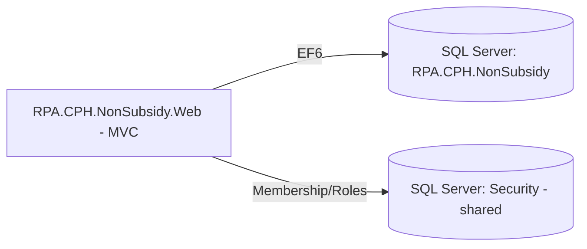

# Assessment - RPA.CPH.NonSubsidy

## Identification

**Repository Name**: rpa-cph-non-subsidy (solution: `RPA.CPH.NonSubsidy`)
**Type**: Web Application (ASP.NET MVC 5) with a separate Domain (class library) layer
**Language**: C#
**Frameworks**: .NET Framework 4.5, ASP.NET MVC 5.2.3, Entity Framework 6.1.3, ASP.NET SQL Membership/Role Provider
**Repository URL**: Local clone only — `rpa-cph-non-subsidy/`

## Summary
RPA.CPH.NonSubsidy is a two-project solution: a `RPA.CPH.NonSubsidy.Domain` class library (EF6 data access/business rules) and a `RPA.CPH.NonSubsidy.Web` ASP.NET MVC front end, each with a paired `.Tests` project. The application is the smallest of the four classic ASP.NET MVC "RPA/CPH" portal-style apps in this portfolio, with a single visible `HomeController`, suggesting either a narrow feature set or that most business logic is expressed through the Domain library and views rather than many distinct controllers.

It participates in the estate's shared authentication model: an `IDTSecurityConnection` pointing at a shared "Security" SQL Server database, using the custom `IDT.Web.Security.RoleProvider` alongside the standard `SqlMembershipProvider`/`SqlProfileProvider`. This is the same shared-auth pattern used by `rpa-inspections-workbench`, `rpa-mts-inspections`, and `rpa-quality-checks`.

## Service Dependencies

### Cloud Services (GCP/AWS/Azure)
- None found — on-prem SQL Server + IIS

### Databases
- **CPHContext** (`RPA.CPH.NonSubsidy`, local SQL Server, `Data Source=.`): primary EF6 application database
- **IDTSecurityConnection** (`Security` DB on `d3vmprwsql003`): shared authentication/authorization database used by the ASP.NET Membership, Profile, and custom Role providers

### Messaging
- None found

### Storage
- None found

### APIs and External Integrations
- None found (no HTTP client/API dependencies observed in this pass)

### Other Dependencies
- **IDT.Web.Security** (custom internal library, likely backed by a checked-in `IDT.dll` as seen in sibling repos) — provides the custom `RoleProvider` implementation; this is a **shared internal dependency across the whole legacy portal estate** and is not open-source/NuGet-hosted
- `BeginCollectionItem`, `PagedList`/`PagedList.Mvc` — common ASP.NET MVC view-model/paging helpers used across the RPA portal estate

## Communication

### Exposed Endpoints
| Method | Path | Description | Authentication |
|--------|------|--------------|-----------------|
| GET | `/` / `/Home/*` (`HomeController`) | Application landing/home pages | ASP.NET Forms Authentication + Membership/Roles (estate-standard pattern; specific `[Authorize]` usage not directly inspected on this controller) |

### Consumed Endpoints
- None found

### Asynchronous Communication
- None found

### Communication Diagram

## Configuration

### Environment Variables
- None — `Web.config` based, no environment-specific transforms found for this app (unlike its siblings which have SIT/UAT/Production transforms)

### Configuration Files
- `Web.config`: connection strings (`CPHContext`, `IDTSecurityConnection`), Membership/Profile/RoleManager provider configuration
- `packages.config`: legacy NuGet dependency pinning

### Secrets and Sensitive Parameters
- SQL connections use Windows Integrated Security — no credentials in source

## Infrastructure

### Containerization
- **Dockerfile**: No

### Kubernetes/Helm
- **Manifests**: No

### Infrastructure as Code
- **Terraform/Bicep**: No

### CI/CD
- **Pipeline**: None found specific to this app (only the generic scaffolded workflow files injected by the migration tooling)

## Testing

### Coverage
- Not measured

### Test Types
- **Unit**: Yes — both `RPA.CPH.NonSubsidy.Domain.Tests` (NUnit 3.6.1) and `RPA.CPH.NonSubsidy.Web.Tests` projects exist
- **Integration/E2E**: Not evident

### Observations
Reasonable test project coverage exists at both the Domain and Web layers, which is a positive signal for safer modernization.

## Points of Attention for Multi-Cloud/Azure Migration

### Cloud-Specific Dependencies
- None (on-prem only), but tightly coupled to the shared on-prem "Security" SQL Server instance (`d3vmprwsql003`) used across the whole legacy estate

### Hardcoded Configurations
- Hardcoded SQL Server hostnames (`d3vmprwsql003`) in `Web.config` — must be parameterized/moved to Key Vault-backed configuration during migration

### Legacy Code or Old Patterns
- .NET Framework 4.5 (out of support) + EF6 + ASP.NET MVC 5 — full modernization to .NET 8/10 and EF Core required
- ASP.NET SQL Membership/Role Provider + a proprietary `IDT.Web.Security.RoleProvider` — this is the **single biggest shared architectural risk in the portfolio**: at least 4 applications (`rpa-cph-non-subsidy`, `rpa-inspections-workbench`, `rpa-mts-inspections`, `rpa-quality-checks`) depend on the same "Security" database and the same closed-source `IDT.dll` assembly for authentication/authorization. Migrating any one of these apps to Azure/Entra ID authentication requires either (a) a coordinated identity migration across all four apps, or (b) a compatibility shim that keeps the shared Security DB alive during a phased cutover.

### Specific Recommendations
1. Treat the shared `IDT.Web.Security`/"Security" database dependency as a **portfolio-level (not per-app) migration decision** — recommend a dedicated identity-migration workstream (e.g., migrate all four dependent apps to Entra ID authentication together, or stand up an identity-bridge/STS in front of the legacy Security DB during a phased rollout).
2. Confirm the actual source/availability of `IDT.dll` — since it is a closed-source internal binary, obtain the source or vendor contact before attempting to decompile/reverse behavior for the migration.
3. Migrate CPHContext (EF6) to EF Core targeting Azure SQL Database.
4. Add environment-specific configuration (this app currently lacks the SIT/UAT/Production `Web.config` transforms present in sibling apps) — confirm whether it is actually deployed to those environments or is dev-only.

## Additional Observations
- This is the smallest/simplest of the four "legacy portal" apps sharing the Security/People database pattern, making it a reasonable **pilot candidate** for validating the shared-authentication migration approach before tackling the larger `rpa-quality-checks` and `rpa-mts-inspections` applications.
